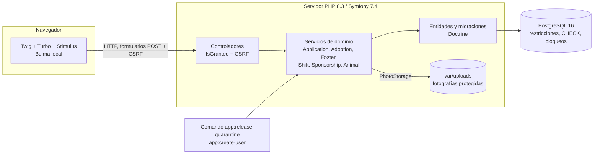
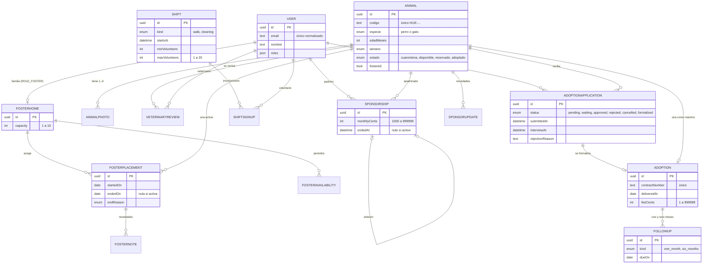

# Memoria del proyecto: Huellas

**Aplicación web para la gestión de adopciones, acogidas, voluntariado y apadrinamientos de una protectora de animales**

Grupo **G27** · Autores: Antonio García Gómez (`aggg15`) y Ana Bernabeu Castillo (`abcb5-ua`) · Fecha de la memoria: 21 de noviembre de 2026 · Estado del código: rama `revision-entrega` (basada en `main`, merge `a74f85f` de la PR #12, más las correcciones de la revisión previa a la entrega; último commit en el momento de redactar: `76223b2`)

---

## Índice

1. [Portada y resumen](#1-portada-y-resumen)
2. [URL del repositorio en GITHUB](#2-url-del-repositorio-en-github)
3. [Introducción](#3-introducción)
4. [Análisis](#4-análisis)
5. [Diseño](#5-diseño)
6. [Implementación](#6-implementación)
7. [Pruebas y validación](#7-pruebas-y-validación)
8. [Despliegue y uso](#8-despliegue-y-uso)
9. [Planificación y seguimiento](#9-planificación-y-seguimiento)
10. [Conclusiones](#10-conclusiones)
11. [Demo](#11-demo)
12. [Anexos](#12-anexos)

---

## 1. Portada y resumen

**Huellas** es una aplicación web para una protectora de animales (descripción SI-30). Cubre el ciclo de vida de un animal desde que llega al refugio hasta que es adoptado, y las actividades de apoyo que lo rodean: la ficha y la cuarentena de diez días con revisión veterinaria, el catálogo público de adopción, la solicitud con cuestionario, la entrevista y la reserva, la formalización con contrato y seguimientos, las casas de acogida, los turnos de voluntariado y el apadrinamiento.

**Para quién.** Seis perfiles con permisos distintos (detalle en [§4.1](#41-actores-y-roles)): visitante anónimo, persona solicitante o padrino (cuenta pública), voluntario, veterinario, coordinadora y familia de acogida.

**Resultado.** Las ocho historias de usuario (HU-01 a HU-08) están implementadas e integradas en `main` mediante las PR #1, #5, #6, #8, #9, #10, #11 y #12, sobre una única aplicación Symfony 7.4 con Twig, Hotwire (Turbo y Stimulus), Doctrine, PostgreSQL y Bulma. La suite completa de PHPUnit, ejecutada el 21 de noviembre de 2026 sobre el árbol de trabajo de la rama `revision-entrega`, termina con **`OK (144 tests, 1659 assertions)`** en todos los pasos del CI reproducido ([registros en el repositorio](evidencias/revision-entrega-2026-11-21/ci-rama-integrada/)), más 1 prueba de la decisión D45 verificada en la suite de Spec003; en `main`, antes de la revisión final, eran 112 pruebas y 1301 aserciones ([§7.2](#72-resultados-de-las-pruebas-automáticas)). Los **62 criterios de aceptación** de las ocho historias tienen tarea y prueba asociadas ([matriz de trazabilidad](trazabilidad.md)). Las pruebas incluyen casos de **concurrencia con procesos PHP independientes** y bloqueos `FOR UPDATE` / `FOR NO KEY UPDATE` ([§7.3](#73-concurrencia-y-reglas-críticas)).

**Cómo se trabajó.** Con **Spec-Driven Development** (Spec Kit 1.0.11): cada historia recorre `specify → clarify → plan → tasks → analyze → implement → converge`, volviendo atrás cuando una fase descubre un fallo (**loop engineering**, [§9.3](#93-iteraciones-y-loop-engineering)). Las fases se aplicaron con asistencia de IA (Codex y Claude Code) siguiendo el procedimiento de las skills de Spec Kit, tal como documentan las propias specs ([§10.2](#102-problemas-encontrados)). Los documentos del ciclo están en [`../specs/`](../specs/).

**Lo que no consta, dicho con claridad.** La ratificación conjunta de la Constitution está registrada como pendiente; la revisión cruzada de la PR #10 (HU-06) y de la PR #12 (HU-08) no consta en el repositorio; la revisión de las correcciones de la rama `revision-entrega` está pendiente; y la columna «Revisado por» de la matriz de trazabilidad está vacía (0/62). Se detalla en [§9.5](#95-issues-y-pull-requests) y [§10.2](#102-problemas-encontrados).

---

## 2. URL del repositorio en GITHUB

El código fuente y la documentación están publicados en GitHub: <https://github.com/aggg15/huellas-protectora>

Rama principal: `main`. Ramas por historia: `spec-001` a `spec-008`. Rama de esta entrega: `revision-entrega`.

---

## 3. Introducción

### 3.1 Contexto

Una protectora de animales mantiene a la vez varios procesos que dependen unos de otros: los animales recién llegados pasan una cuarentena antes de poder adoptarse; las personas interesadas consultan un catálogo público y envían solicitudes; la coordinadora entrevista, decide y reserva; unas familias acogen animales temporalmente; los voluntarios cubren turnos de paseo y limpieza; y los padrinos aportan una cuota mensual por un animal concreto. La práctica pide construir el sistema como **una sola aplicación** repartida en ocho historias de usuario que dos personas desarrollan en paralelo, con un plan técnico y un modelo de datos comunes.

### 3.2 Problema que resuelve

- **Un animal, una reserva.** Dos decisiones simultáneas de la coordinadora (o una aprobación y un rechazo sobre la misma solicitud) no deben dejar al animal reservado para dos familias ni la solicitud en un estado mezclado.
- **Cuarentena fiable.** Un animal no es visible en la web durante diez periodos de 24 horas desde su recepción y pasa a disponible después, sin depender de una tarea programada.
- **Límites que se cumplen aunque haya prisas.** Como máximo dos solicitudes abiertas por persona, la capacidad de cada casa de acogida, el aforo de cada turno y un único apadrinamiento activo por cuenta y animal deben respetarse también con peticiones simultáneas.
- **Coherencia entre historias.** Formalizar una adopción debe cerrar las demás solicitudes del animal, finalizar su acogida y dejar listo el dato que HU-08 usa para ofrecer al padrino otra opción.
- **Privacidad.** El catálogo público no revela animales en cuarentena, reservados o adoptados; las novedades de acogida son internas; cada persona solo ve lo suyo.

### 3.3 Objetivos

1. Implementar las ocho historias (HU-01 a HU-08) sobre un plan técnico ([`../plan.md`](../plan.md)) y un modelo de datos ([`../data-model.md`](../data-model.md)) únicos, con cuatro historias por integrante.
2. Aplicar el ciclo `specify → clarify → plan → tasks → analyze → implement → converge` a cada historia, conservar las iteraciones y mantener la trazabilidad criterio → decisión → tarea → prueba.
3. Que las reglas críticas se cumplan en el servidor y también en la base de datos (restricciones únicas parciales, `CHECK`, bloqueos de fila), demostrado con pruebas de concurrencia.
4. Interfaz en español, con éxito, error y ausencia de resultados explicados, utilizable en móvil y por teclado (principio V de la Constitution).
5. Evidencias reproducibles: pruebas automáticas contra PostgreSQL real, recorridos manuales con resultado esperado y observado, y una demo en vídeo.

### 3.4 Constitución del proyecto

El proyecto se rige por [`.specify/memory/constitution.md`](../.specify/memory/constitution.md), versión 1.1.1 (última modificación: 18 de noviembre de 2026). El propio documento indica que es una **propuesta inicial preparada para revisión conjunta de los dos integrantes** y que su ratificación está **pendiente de revisión conjunta**; por eso en esta memoria se trata como el conjunto de reglas de trabajo aplicadas en el proyecto, sin afirmar una ratificación que no consta. Sus cinco principios son:

| Principio | Resumen |
|---|---|
| I. Fidelidad a la narrativa y alcance explícito | La descripción SI-30 define las necesidades; toda funcionalidad se vincula a una historia HU-01..HU-08. Las ambigüedades se registran y resuelven con `clarify`, distinguiendo el texto del enunciado de las decisiones del equipo. Quedan fuera la contabilidad general y las campañas de pienso. |
| II. Especificación previa, criterios verificables y trazabilidad | Cada historia tiene spec antes de implementarse; criterios «Dado… Cuando… Entonces…» con identificadores `CA-XX-YY`; debe poder recorrerse historia y criterio → decisión del plan → tarea → implementación y comprobación. Una tarea marcada no sustituye la evidencia. |
| III. Una aplicación y una base técnica compartidas | Una única aplicación con plan y modelo comunes; convenciones de Symfony; separación entre presentación, reglas y persistencia; validación en servidor; coherencia aunque falle una operación o concurran peticiones; la solución más sencilla que cumpla. |
| IV. Responsabilidad individual y coordinación | Cuatro historias por integrante, ramas `spec-001..008`, PR revisadas por el compañero, commits concretos, cambios compartidos acordados; en la revisión cruzada se comprueba al menos un criterio de cada historia del compañero. |
| V. Calidad y cierre demostrables | Una historia se cierra con todos sus criterios comprobados y registrados: recorrido habitual, entrada inválida o límite y permisos o estado; interfaz en español, móvil, escritorio y teclado; datos ficticios; verificaciones manuales con precondiciones, pasos, resultado esperado y observado, y versión. |

La sección «Flujo de desarrollo y revisión» de la Constitution fija el bucle de trabajo: `analyze` informa, `converge` contrasta el código y añade tareas correctivas al final de `tasks.md` sin borrar las anteriores, y se prohíbe «inventar fallos» o añadir tareas «para aparentar iteración». Esa regla se ha seguido: las pasadas de converge sin hallazgos no añaden tareas ([§9.3](#93-iteraciones-y-loop-engineering)).

---

## 4. Análisis

### 4.1 Actores y roles

| Actor | Rol técnico | Qué puede hacer |
|---|---|---|
| Visitante anónimo | (sin cuenta) | Consultar el catálogo público y la ficha de los animales disponibles (HU-02). |
| Persona solicitante o padrino | `ROLE_USER` (alta pública en `/registro`) | Enviar solicitudes de adopción y verlas en «Mis solicitudes» (HU-03/04); apadrinar y ver sus apadrinamientos y novedades (HU-08). |
| Voluntario | `ROLE_VOLUNTEER` (⊂ `ROLE_STAFF`) | Dar de alta animales (HU-01); consultar turnos e inscribirse (HU-07). |
| Veterinario | `ROLE_VET` (⊂ `ROLE_STAFF`) | Registrar la revisión veterinaria (HU-01). No puede crear animales ni acceder a los turnos. |
| Coordinadora | `ROLE_COORDINATOR` (⊂ `ROLE_STAFF`, `ROLE_VOLUNTEER`) | Revisar solicitudes, entrevistar, aprobar, rechazar y liberar reservas (HU-04); formalizar adopciones y consultar seguimientos (HU-05); registrar y finalizar acogidas (HU-06); crear y modificar turnos (HU-07); publicar novedades para padrinos (HU-08). |
| Familia de acogida | `ROLE_FOSTER` (fuera de `ROLE_STAFF`) | Indicar capacidad y disponibilidad de su casa y anotar novedades de los animales acogidos (HU-06). |

Las cuentas de personal y de familias de acogida se crean por comando (`app:create-user`); el registro público solo crea `ROLE_USER` (decisiones [D06](decisiones.md), [D19](decisiones.md), [D26](decisiones.md), [D34](decisiones.md)). La jerarquía de roles está en [`../config/packages/security.yaml`](../config/packages/security.yaml). La autenticación es soporte común, no una novena historia.

### 4.2 Historias de usuario

Las fichas iniciales están en [`../spec-001/historia.md`](../spec-001/historia.md) a [`../spec-008/historia.md`](../spec-008/historia.md); las specs vigentes, en `../specs/spec-00N/spec.md`. Reparto: `aggg15` HU-01, HU-03, HU-05 y HU-07; `abcb5-ua` HU-02, HU-04, HU-06 y HU-08 ([`agrupamiento.md`](agrupamiento.md)).

| HU | Historia (resumen del «Como… quiero… para…» de la spec) | Responsable | Criterios (CA) | Spec |
|---|---|---|---|---|
| HU-01 | Como **voluntario que recibe animales**, quiero abrir la ficha de cada animal y reflejar su cuarentena y revisión veterinaria, para ofrecerlo en adopción cuando haya pasado el periodo. | `aggg15` | 5 | [spec-001](../specs/spec-001/spec.md) |
| HU-02 | Como **persona interesada en adoptar**, quiero consultar sin registrarme los animales que buscan hogar y filtrarlos por especie, tamaño y edad. | `abcb5-ua` | 4 | [spec-002](../specs/spec-002/spec.md) |
| HU-03 | Como **persona que quiere adoptar**, quiero enviar una solicitud con un cuestionario completo sobre vivienda, experiencia y disponibilidad. | `aggg15` | 6 (4 + 2 derivados) | [spec-003](../specs/spec-003/spec.md) |
| HU-04 | Como **coordinadora de adopciones**, quiero revisar solicitudes, concertar entrevistas y decidir, para reservar cada animal a una familia y conservar las alternativas en espera. | `abcb5-ua` | 5 | [spec-004](../specs/spec-004/spec.md) |
| HU-05 | Como **coordinadora de adopciones**, quiero formalizar la entrega mediante contrato y abono de la cuota y dejar programados los dos seguimientos. | `aggg15` | 11 (5 + 6 derivados) | [spec-005](../specs/spec-005/spec.md) |
| HU-06 | Como **familia de acogida**, quiero indicar mi disponibilidad y capacidad y registrar las novedades de los animales que acojo. | `abcb5-ua` | 10 (5 + 5 derivados) | [spec-006](../specs/spec-006/spec.md) |
| HU-07 | Como **voluntario del refugio**, quiero consultar los turnos de paseo y limpieza e inscribirme en los que tienen plazas, y detectar los que necesitan más personas. | `aggg15` | 11 (5 + 6 derivados) | [spec-007](../specs/spec-007/spec.md) |
| HU-08 | Como **padrino o madrina**, quiero apoyar a un animal con una aportación mensual y recibir sus novedades, y decidir cómo continuar cuando sea adoptado. | `abcb5-ua` | 10 (5 + 5 derivados) | [spec-008](../specs/spec-008/spec.md) |
| | **Total** | | **62** (38 iniciales, 24 derivados en `clarify`) | |

Cada historia se prueba en tres situaciones (habitual, entrada inválida o límite, permisos o estado) y tiene un registro de preguntas de `clarify` con respuesta, justificación y diferencias respecto a la ficha inicial: 73 preguntas registradas en total (7, 6, 9, 9, 12, 12, 10 y 8 por historia; véase cada `clarify.md`). Los criterios «derivados» son los que `clarify` añadió a los iniciales de la ficha (por ejemplo, CA-03-06 «Envíos simultáneos» o CA-05-10 «Una sola adopción ante concurrencia»).

### 4.3 Requisitos funcionales

Los requisitos de SI-30 se numeran aquí como RF-n (numeración propia de esta memoria, que resume el texto de la descripción) y se asocian a la historia que los implementa. El detalle por criterio está en la [matriz de trazabilidad](trazabilidad.md).

| RF | Requisito (SI-30) | HU |
|---|---|---|
| RF-1 | Ficha de cada animal: código, especie, edad aproximada, procedencia y fotos. | HU-01 |
| RF-2 | Cuarentena de 10 días con revisión del veterinario. | HU-01 |
| RF-3 | El animal no es visible en la web durante la cuarentena; después, queda disponible. | HU-01, HU-02 |
| RF-4 | Catálogo público sin registro. | HU-02 |
| RF-5 | Filtros por especie, tamaño y edad; solo animales en adopción; los acogidos se muestran con su indicación. | HU-02, HU-06 |
| RF-6 | Solicitud con cuestionario (vivienda, experiencia, disponibilidad); sin cuestionarios a medias. | HU-03 |
| RF-7 | Como máximo 2 solicitudes abiertas por persona. | HU-03 |
| RF-8 | La coordinadora revisa, entrevista y decide; el rechazo exige motivo escrito. | HU-04 |
| RF-9 | La aprobación reserva el animal; las demás solicitudes quedan en espera, no se rechazan. | HU-04 |
| RF-10 | Formalización el día de la entrega: contrato, cuota y estado «adoptado». | HU-05 |
| RF-11 | Seguimientos programados al mes y a los 6 meses. | HU-05 |
| RF-12 | Casas de acogida con disponibilidad y número máximo de animales; el animal acogido sigue buscando familia. | HU-06 |
| RF-13 | La familia de acogida anota novedades. | HU-06 |
| RF-14 | Turnos de paseo y limpieza con inscripción libre, mínimo y aforo máximo. | HU-07 |
| RF-15 | Los turnos sin el mínimo se destacan cuando faltan 48 h o menos. | HU-07 |
| RF-16 | Padrino con aportación mensual mínima de 10 €; recibe las novedades de su ahijado. | HU-08 |
| RF-17 | Cuando el animal es adoptado, se propone al padrino apadrinar otro o terminar. | HU-08 |

Fuera de alcance (SI-30 y Constitution I): contabilidad y campañas de pienso. Sin verificación de email, recuperación de contraseña, pasarela de pago, firma electrónica ni envío de correos ([decisiones](decisiones.md)).

**Valores de negocio destacados** (decisiones [D01–D45](decisiones.md)):

| Valor | Cifra | Decisión |
|---|---|---|
| Cuarentena | 240 horas (10 × 24 h) desde la recepción en UTC | D01 |
| Fotos por animal | 1 a 6, JPEG/PNG/WebP, máximo 5 MiB, comprobadas por contenido | D04 |
| Edad en filtros | menos de 12 meses; 12 a 83; desde 84 | D05 |
| Solicitudes abiertas por cuenta | 2 (pendiente, en espera y aprobada cuentan como abiertas) | D07 |
| Quién solicita adopciones | cuentas públicas y familias de acogida; el personal de la protectora no (403) | D45 |
| Cuota de adopción | mayor que 0 y hasta 9 999,99 €, con confirmación del abono | D14 |
| Seguimientos | al mes y a los seis meses; último día del mes si el día no existe | D16 |
| Casa de acogida | capacidad de 1 a 10 | D20 |
| Turno | 1 ≤ mínimo ≤ máximo ≤ 20; destacado si faltan 48 h reales o menos y hay menos inscritos que el mínimo | D27, D31 |
| Aportación de apadrinamiento | de 10,00 € a 9 999,99 € al mes | D36 |

### 4.4 Requisitos no funcionales

| Ámbito | Requisito | Fuente |
|---|---|---|
| Fiabilidad y concurrencia | Las reglas críticas (máximo de dos solicitudes, una reserva por animal, una adopción por animal, capacidad de acogida, aforo de turno, un apadrinamiento activo) se mantienen con peticiones simultáneas; los errores no dejan cambios parciales. | Constitution III y V; plan común; D07, D10, D17, D21, D33, D41 |
| Integridad en base de datos | Restricciones únicas parciales, `CHECK` y claves foráneas en PostgreSQL, además de las comprobaciones del servicio. | [`../data-model.md`](../data-model.md) |
| Seguridad | Roles por ruta (`IsGranted`), mutaciones solo por `POST` con token CSRF, redirecciones `303`, formularios inválidos `422`, escape automático de Twig, identificadores UUID opacos, fotos fuera de `public/` y servidas con comprobación de estado. | [`../plan.md`](../plan.md), D04 |
| Privacidad | Datos ficticios en pruebas y demo; las notas de acogida son internas; solo las personas implicadas ven el contrato. | Constitution V; D13, D24 |
| Tiempo y zona horaria | Fechas de negocio en UTC y presentación en `Europe/Madrid`; cambios de hora tratados explícitamente (turnos, seguimientos). | [`../data-model.md`](../data-model.md); D16, D27, D31 |
| Usabilidad y accesibilidad | Interfaz en español; estados de éxito, error y vacío; campos etiquetados; uso en móvil (≈ 390 px), escritorio y teclado. | Constitution V |
| Mantenibilidad | Estructura estándar de Symfony; controladores finos, reglas en servicios; una migración por cambio de esquema. | [`../plan.md`](../plan.md) |
| Reproducibilidad | PostgreSQL por Docker Compose, configuración local generada, CI en cada PR. | [`../README.md`](../README.md), [`../.github/workflows/ci.yml`](../.github/workflows/ci.yml) |

### 4.5 Reglas que cruzan historias

La parte delicada del análisis es qué hace cada historia sobre los datos de las demás. Las reglas acordadas (plan común, decisiones y specs) son:

1. **HU-01 → HU-02.** La cuarentena vencida se promociona a «disponible» antes de consultar el catálogo (y por el comando `app:release-quarantine`); el catálogo solo muestra animales disponibles ([D01](decisiones.md)).
2. **HU-03 → HU-04.** Una solicitud cuenta como abierta si está pendiente, en espera o aprobada ([D07](decisiones.md)). No se admiten solicitudes de un animal reservado ([D10](decisiones.md)); si el animal se reserva mientras se rellena el formulario, el envío responde 409 ([D43](decisiones.md)). El personal de la protectora no presenta solicitudes con su cuenta de trabajo y las familias de acogida sí ([D45](decisiones.md)).
3. **HU-04.** Aprobar exige una entrevista registrada no futura y, desde la revisión final, no anterior al envío ([D09](decisiones.md), [D42](decisiones.md)); reserva el animal y pasa las demás solicitudes pendientes a «en espera». Liberar la reserva exige motivo y devuelve el animal a «disponible» y las esperas a «pendiente» ([D11](decisiones.md)).
4. **HU-05 sobre HU-03, HU-04 y HU-06.** Formalizar, en una sola transacción, marca la solicitud como «formalizada» (deja de contar como abierta), el animal como «adoptado» y fuera de acogida, cancela las demás solicitudes abiertas con el motivo «El animal ha sido adoptado», finaliza la acogida activa y crea la adopción con contrato inmutable y dos seguimientos ([D15](decisiones.md), [D25](decisiones.md), [D16](decisiones.md)). Ya no se puede liberar esa reserva ([D17](decisiones.md)).
5. **HU-06 → HU-02.** La acogida no cambia el estado del animal ni su reserva; un animal disponible en acogida sigue en el catálogo con la indicación «En casa de acogida» ([D25](decisiones.md)). Las notas de acogida son internas y no llegan a los padrinos ([D24](decisiones.md), [D37](decisiones.md)).
6. **HU-05 → HU-08.** La adopción registrada (animal, adoptante y fecha) es el dato con el que HU-08 calcula que un apadrinamiento activo queda «pendiente de decisión», con la aportación en pausa desde la fecha de entrega ([D18](decisiones.md), [D38](decisiones.md)); HU-08 no modifica HU-05.
7. **Orden de bloqueo común.** Toda operación que cambia estado relee el estado después de obtener el bloqueo. Orden por historia: HU-03 cuenta → animal; HU-04 y HU-05 animal → solicitud; HU-06 animal → casa → acogida; HU-07 cuenta → turno; HU-08 cuenta → apadrinamiento → animal. Los órdenes se fijaron en el plan para que los caminos de distintas historias no formen ciclos (D41: «sin ciclos con la formalización de HU-05»; [`../plan.md`](../plan.md), D17, D21, D33).

---

## 5. Diseño

### 5.1 Arquitectura

Una aplicación **Symfony 7.4** (PHP 8.3) con vistas **Twig**, **Hotwire** (Turbo para navegación y formularios; Stimulus para previsualización de fotos y comportamientos de formularios), **Doctrine ORM** sobre **PostgreSQL 16** y **Bulma** servido localmente. Los controladores traducen HTTP; los servicios aplican reglas y transacciones; las entidades y migraciones definen el modelo común. No se crean ocho aplicaciones independientes ([`../plan.md`](../plan.md)). La referencia a `apps/` y `packages/` del índice del ejemplo del profesor es propia de un monorepo y no se aplica: se usa la estructura estándar de Symfony.



Estructura de capas y responsabilidades:

- **`src/Controller`** (13 controladores): catálogo público, acceso y registro, administración por rol. Cada acción de escritura es `POST` con token CSRF.
- **`src/Service`** (servicios de dominio): `AnimalService` (ficha, cuarentena, catálogo), `ApplicationService` (solicitudes y decisiones), `AdoptionService` (formalización), `FosterService` (acogidas), `ShiftService` y `ShiftCoverage` (turnos), `SponsorshipService` (apadrinamientos), `FollowUpCalendar`, `AvailabilityCalendar`, `TextNormalizer`, `PhotoStorage`, y excepciones de rechazo por dominio (`ApplicationRefused`, `FosterRefused`, `ShiftRefused`, `SponsorshipRefused`, `ValidationError`).
- **`src/Entity`**: 15 entidades (véase [§5.2](#52-modelo-de-datos)).
- **`templates/`** (32 plantillas Twig) y **`public/assets`** (Bulma, Turbo y Stimulus copiados con `npm run build`; sin CDN en ejecución).
- **`migrations/`**: 10 migraciones acumulativas ([`../migrations/`](../migrations/)).
- **`var/uploads/`**: fotografías fuera del directorio público; `MediaController` las entrega tras comprobar estado y permisos.
- **`tests/`**: pruebas HTTP y de servicio con PostgreSQL real, independientes de la base de demostración.

Sin tareas programadas: la cuarentena vencida se promociona al consultar (o por comando), el destacado de turnos y los estados «pendiente de decisión» se calculan en cada consulta.

### 5.2 Modelo de datos

Definido en [`../data-model.md`](../data-model.md), compartido por las ocho historias. Identificadores UUID, fechas de negocio en UTC y presentación en `Europe/Madrid`. Cada historia que amplía el modelo lo hace con una migración y una actualización de `data-model.md`.



**Restricciones que sostienen las reglas en la propia base de datos** (todas declaradas también en el mapeo, con `doctrine:schema:validate` correcto):

| Restricción | Regla que protege | Migración |
|---|---|---|
| `CHECK` de cuestionario completo en `AdoptionApplication` | Sin cuestionarios a medias (CA-03-02) | [`Version20261117090718`](../migrations/Version20261117090718.php) |
| Único parcial `uniq_application_approved_animal` `(animal_id) WHERE status = 'approved'` | Una sola reserva por animal (CA-04-05) | [`Version20261117120000`](../migrations/Version20261117120000.php), [`Version20261118211500`](../migrations/Version20261118211500.php) |
| Único parcial `uniq_application_open_applicant_animal` `(applicant_id, animal_id) WHERE status IN ('pending','waiting','approved')` | Sin duplicados abiertos de la misma cuenta y animal | [`Version20261121100000`](../migrations/Version20261121100000.php) |
| Únicos sobre animal, solicitud y número de contrato en `Adoption`; `CHECK` de cuota; único `(adopción, kind)` en `FollowUp` | Una sola adopción por animal y solicitud; dos seguimientos | [`Version20261118230000`](../migrations/Version20261118230000.php) |
| Único parcial de acogida activa por animal; casa única por cuenta; `CHECK` de capacidad y fechas | Una acogida activa por animal | [`Version20261119120000`](../migrations/Version20261119120000.php) |
| Único `(turno, voluntario)`; `CHECK` 1 ≤ mínimo ≤ máximo ≤ 20 | Sin doble inscripción | [`Version20261119180000`](../migrations/Version20261119180000.php) |
| Único parcial `uniq_sponsorship_active` `(animal, padrino) WHERE endedAt IS NULL`; `CHECK` de importe y de longitud del texto | Un apadrinamiento activo por cuenta y animal | [`Version20261119190000`](../migrations/Version20261119190000.php) |

**Estados del animal y de la solicitud**

```text
Animal:     cuarentena ──(240 h)──► disponible ──(HU-04 aprobar)──► reservado ──(HU-05 formalizar)──► adoptado
                                        ▲                               │
                                        └──(HU-04 liberar con motivo)───┘

Solicitud:  pendiente ──(HU-04 aprobar)──► aprobada ──(HU-05 formalizar)──► formalizada
            pendiente ──(HU-04 rechazar con motivo)──► rechazada
            pendiente ──(otra aprobada)──► en espera ──(liberación)──► pendiente
            abiertas ──(animal adoptado)──► cancelada ("El animal ha sido adoptado")
```

### 5.3 Contrato (rutas y controladores)

No hay API JSON: la interfaz es servida por Twig y Turbo. El «contrato» son las rutas HTTP, el rol exigido y el código de respuesta para cada caso. Convenciones: toda mutación es `POST` con CSRF; éxito `303`; formulario inválido `422`; conflicto de estado `409` ([D43](decisiones.md)); recurso no público o ajeno `404`; sin permiso `403`; anónimo en ruta protegida, redirección a `/acceso`.

| Historia | Ruta | Método | Acceso | Controlador |
|---|---|---|---|---|
| Base | `/`, `/acceso`, `/salir`, `/panel` | GET/POST | público / autenticado | [`SecurityController`](../src/Controller/SecurityController.php) |
| HU-03 | `/registro` | GET/POST | público (solo `ROLE_USER`) | [`AccountController`](../src/Controller/AccountController.php) |
| HU-01 | `/admin/animales`, `/admin/animales/nuevo`, `/admin/animales/{id}` | GET/POST | `ROLE_STAFF` (alta: `ROLE_VOLUNTEER`) | [`AnimalController`](../src/Controller/AnimalController.php) |
| HU-01 | `/admin/animales/{id}/revision` | POST | `ROLE_VET` | `AnimalController` |
| HU-01/02 | `/fotos/{id}` | GET | público si el animal es público; personal siempre | [`MediaController`](../src/Controller/MediaController.php) |
| HU-02 | `/animales`, `/animales/{id}` | GET | público | [`PublicAnimalController`](../src/Controller/PublicAnimalController.php) |
| HU-03 | `/animales/{id}/solicitud`, `/mis-solicitudes` | GET/POST, GET | `ROLE_USER` | [`ApplicationController`](../src/Controller/ApplicationController.php) |
| HU-04 | `/admin/solicitudes`, `/admin/solicitudes/{id}` | GET | `ROLE_COORDINATOR` | [`ApplicationReviewController`](../src/Controller/ApplicationReviewController.php) |
| HU-04 | `/admin/solicitudes/{id}/entrevista`, `/aprobar`, `/rechazar`, `/cancelar-reserva` | POST | `ROLE_COORDINATOR` | `ApplicationReviewController` |
| HU-05 | `/admin/solicitudes/{id}/formalizar` | POST | `ROLE_COORDINATOR` | `ApplicationReviewController` |
| HU-05 | `/admin/adopciones/{id}`, `/admin/seguimientos`, `/adopciones/{id}/contrato` | GET | coordinadora; contrato: coordinadora y adoptante | [`AdoptionController`](../src/Controller/AdoptionController.php) |
| HU-06 | `/acogida`, `/acogida/capacidad`, `/acogida/periodos`, `/acogida/periodos/{id}/eliminar`, `/acogida/acogidas/{id}/novedades` | GET/POST | `ROLE_FOSTER` | [`FosterController`](../src/Controller/FosterController.php) |
| HU-06 | `/admin/acogidas`, `/admin/animales/{id}/acogida`, `/admin/acogidas/{id}/finalizar` | GET/POST | `ROLE_COORDINATOR` | [`FosterAdminController`](../src/Controller/FosterAdminController.php) |
| HU-07 | `/admin/turnos`, `/admin/turnos/{id}`, `/inscripcion`, `/baja` | GET/POST | `ROLE_VOLUNTEER` | [`ShiftController`](../src/Controller/ShiftController.php) |
| HU-07 | `/admin/turnos/nuevo`, `/admin/turnos/{id}/editar` | GET/POST | `ROLE_COORDINATOR` | `ShiftController` |
| HU-08 | `/animales/{id}/apadrinar`, `/mis-apadrinamientos`, `…/{id}/terminar`, `…/{id}/cambiar` | GET/POST | `ROLE_USER` (personal y familias: 403) | [`SponsorshipController`](../src/Controller/SponsorshipController.php) |
| HU-08 | `/admin/apadrinamientos`, `…/{id}/novedades` | GET/POST | `ROLE_COORDINATOR` | [`SponsorshipAdminController`](../src/Controller/SponsorshipAdminController.php) |

Los permisos y el CSRF de cada ruta tienen su prueba (por ejemplo `testReviewActionsRequireValidCsrfTokenAndCoordinatorRole` en HU-04, `testShiftFormsRequireCsrf` en HU-07). Los planes por historia ([`../specs/spec-00N/plan.md`](../specs/spec-001/plan.md)) detallan rutas, vistas y servicios, y referencian el plan común.

### 5.4 Decisiones técnicas y por qué se tomaron

Las decisiones de producto y de diseño están numeradas D01–D45 en [`decisiones.md`](decisiones.md), cada una con motivo e historia. Las de mayor impacto técnico:

| Decisión | Por qué | Alternativa descartada |
|---|---|---|
| **Una aplicación Symfony con servicios por historia** y plan/modelo comunes (Constitution III). | Un modelo único evita estados incompatibles entre historias; los servicios concentran las reglas y las transacciones. | Ocho aplicaciones o módulos independientes. |
| **Cuarentena de 240 horas desde recepción UTC, promoción al consultar o por comando** (D01). | Evita ambigüedad de medianoches y cambios horarios; no exige un planificador. | Tarea programada; «10 días naturales». |
| **Bloqueos de fila y relectura bajo bloqueo** en toda operación que cambie estado (plan común; D07, D17, D21, D33, D41), más restricciones únicas parciales en PostgreSQL. | Sostienen «un animal, una reserva», el máximo de dos solicitudes, la capacidad y el aforo con peticiones simultáneas. | Confiar solo en comprobaciones de la aplicación antes de escribir. |
| **`FOR NO KEY UPDATE` sobre la cuenta** en solicitudes, inscripciones y apadrinamientos (C2-03, revisión final). | El `FOR UPDATE` de la cuenta chocaba con la clave foránea de `Adoption` (inserción en la formalización) y podía interbloquear; `FOR NO KEY UPDATE` mantiene la serialización por cuenta sin ese conflicto. | `FOR UPDATE` en todos los casos. |
| **Escritura por SQL del indicador `fostered` y de los cambios de turno** (implement de HU-06 y HU-07). | Doctrine no escribe un valor que coincide con la copia de la entidad cargada antes de otro cambio; la carrera adopción/acogida lo demuestra. | Asignar solo en la entidad. |
| **Contrato como HTML imprimible inmutable** con copia de datos en `Adoption` (D13). | Hace verificable «se genera un contrato» sin servicios ajenos; no cambia aunque cambien cuenta o animal después. | PDF o firma electrónica (excluidos por la ficha). |
| **Estados derivados en lugar de columnas o tareas** (destacado de turnos D31, «pendiente de decisión» D38). | Se calculan en cada consulta con el reloj inyectable; sin planificadores ni estados que se desincronicen. | Tareas programadas. |
| **Reloj inyectable y fechas en UTC con presentación en `Europe/Madrid`**; zona PHP fijada a UTC (C1-14). | Permite probar cambios de hora y límites exactos (240 h, 48 h). | `now()` disperso. |
| **Códigos HTTP coherentes**: 409 para conflicto de estado, 422 para validación (D43). | La liberación y la formalización ya lo hacían; la revisión final lo extendió a decidir solicitudes y a enviar sobre un animal reservado. | Mezclar 422 y 404 según la historia. |
| **Textos libres normalizados con `TextNormalizer`** (D44). | `trim()` de PHP no recorta espacios Unicode ni rechaza NUL; un NUL o UTF-8 inválido daba 500. | `trim()` en cada servicio. |

---

## 6. Implementación

### 6.1 Pila tecnológica

| Capa | Tecnología |
|---|---|
| Lenguaje y framework | PHP 8.3 (`composer.json`: `>=8.3`), Symfony 7.4 |
| Persistencia | Doctrine ORM 3.3, Doctrine Migrations, PostgreSQL 16 |
| Vistas y frontend | Twig, Hotwire Turbo 8 y Stimulus 3, Bulma 1 (copiados a `public/assets` con `npm run build`) |
| Seguridad | Symfony Security (`form_login`, jerarquía de roles, `IsGranted`), CSRF |
| Pruebas | PHPUnit 11.5 con `WebTestCase`/`KernelBrowser` y PostgreSQL real; procesos PHP auxiliares para concurrencia |
| Calidad | `lint:container`, `lint:twig`, `lint:yaml`, `php -l`, `doctrine:schema:validate`, `composer validate --strict` |
| Entorno | Docker Compose (PostgreSQL 16-alpine), GitHub Actions (CI), Spec Kit 1.0.11 |
| Demo | Playwright (`tools/demo/`) |

### 6.2 Estructura del repositorio

Tamaño aproximado: ~3 400 líneas de PHP en `src/` (controladores, servicios, entidades), 32 plantillas Twig, 10 migraciones, ~4 450 líneas de PHP de pruebas (`tests/`, con 1 659 aserciones en la suite completa).

```text
huellas-protectora/
├── src/{Controller,Entity,Service,Command}   # 13 controladores, 15 entidades, servicios por historia
├── templates/                                 # 32 plantillas Twig (vistas y páginas de error en español)
├── public/{index.php,router.php,assets/}      # entrada web y recursos locales
├── migrations/                                # 10 migraciones Doctrine
├── config/                                    # framework, doctrine, security, twig
├── tests/{Spec001Test.php … Spec008Test.php, WebTestBase.php, bootstrap.php, Support/*}
├── specs/spec-001 … spec-008/                 # spec, clarify, plan, tasks, analyze, implement, converge
├── spec-001/ … spec-008/                      # fichas iniciales (historia.md)
├── docs/                                      # agrupamiento, decisiones, trazabilidad, revisión cruzada, evidencias, memoria
├── .specify/ y .agents/skills/                # Spec Kit 1.0.11: constitution, plantillas, scripts, skills
├── tools/{configure.php,spec-context.sh,demo/}# configuración local, contexto Spec Kit, demo en vídeo
├── plan.md, data-model.md                     # plan común y modelo de datos compartido
└── compose.yaml, .env.example, .github/workflows/ci.yml
```

### 6.3 Partes más relevantes del código

**a) Solicitud con límite de dos bajo concurrencia** — [`ApplicationService::submit`](../src/Service/ApplicationService.php). En una transacción bloquea la cuenta con `FOR NO KEY UPDATE` y el animal con `FOR UPDATE`, relee el estado y cuenta las solicitudes abiertas antes de insertar. El índice único parcial `uniq_application_open_applicant_animal` es la última defensa.

**b) Decisiones de la coordinadora sin carreras** — `ApplicationService::approve`, `reject` y `recordInterview` se ejecutan en `wrapInTransaction`, bloquean primero el animal y después la solicitud, recargan ambos bajo bloqueo y revalidan antes de mutar. El conflicto de estado responde 409. Se añadieron en la revisión final (T414); la prueba con procesos independientes está en [`../tests/Support/application-race.php`](../tests/Support/application-race.php).

**c) Formalización atómica** — [`AdoptionService::formalize`](../src/Service/AdoptionService.php): un único bloqueo de animal y solicitud, relectura, creación de `Adoption` con copia del contrato, dos `FollowUp` calculados por [`FollowUpCalendar`](../src/Service/FollowUpCalendar.php) (último día del mes si no existe el día), cierre de las demás solicitudes y fin de la acogida activa.

**d) Capacidad de acogida y orden de bloqueos** — [`FosterService`](../src/Service/FosterService.php): registrar una acogida bloquea animal y casa, comprueba disponibilidad continua en todos los días del intervalo ([`AvailabilityCalendar`](../src/Service/AvailabilityCalendar.php)) y que las acogidas activas no superan la capacidad. `fostered` se escribe por SQL.

**e) Turnos: cobertura y hora local** — [`ShiftService`](../src/Service/ShiftService.php) y [`ShiftCoverage`](../src/Service/ShiftCoverage.php): inscribirse bloquea cuenta y turno y revalida plazas, doble inscripción, coincidencias e inicio. El «falto de voluntarios» se calcula con instantes UTC (48 horas reales, también en cambios de hora). `ShiftController` rellena con `''` los campos ausentes del `POST` para responder 422 y no 500 con `twig.strict_variables` (C2-01).

**f) Apadrinamiento y continuidad** — [`SponsorshipService`](../src/Service/SponsorshipService.php): apadrinar bloquea cuenta y después animal; cambiar de animal termina el anterior con «Cambio a otro animal» y crea el nuevo enlazado, en una transacción; el estado «pendiente de decisión» se deriva de la adopción (D18, D38).

**g) Fotografías protegidas** — [`PhotoStorage`](../src/Service/PhotoStorage.php) y [`MediaController`](../src/Controller/MediaController.php): nombres generados, tipo real comprobado por contenido, almacén fuera de `public/`, entrega solo si el animal es público o el solicitante es personal; en pruebas se usa `var/uploads_test`.

**h) Páginas de error en español y UTC** — plantillas `error`, `error403` y `error404` bajo `templates/bundles/TwigBundle/Exception/`; zona PHP fijada a UTC en `Kernel` y `tests/bootstrap.php` (C1-06, C1-14).

### 6.4 Decisiones tomadas sobre la marcha

Recogidas en los `implement.md` y en los converge de cada spec:

- **`fostered` y cambios de turno por SQL** (HU-06/HU-07): una entidad cargada antes de otro cambio no escribe valores que coinciden con su copia; se detectó con la prueba de carrera adopción/acogida (sin la sentencia queda un animal adoptado con `fostered = true`).
- **Hora repetida de octubre** (HU-07): `createFromFormat` tomaba la segunda 02:30; la prueba lo detectó y el servicio usa la primera, como fija la spec.
- **Comparación de turnos por minutos** (HU-07): el formulario no tiene segundos; comparar instantes exactos producía 409 y 422 indebidos.
- **Rol comprobado también en el servicio** (HU-08): la prueba de permisos llamaba al servicio directamente y habría creado apadrinamientos de personal.
- **Migración renombrada** (HU-08): el diff la nombró `Version20261119174701`, anterior a la de HU-07; la comprobación down/up lo detectó y se renombró a `Version20261119190000` sin cambiar su SQL.
- **EntityManager cerrado tras un rechazo** (HU-05/06/08): `wrapInTransaction` cierra el EntityManager al fallar; los rechazos se lanzan antes de modificar entidades y las pruebas de servicio usan un EntityManager nuevo.
- **Una prueba de HU-02 falló en `main`** por leer una entidad cacheada (`testExpiredQuarantinePromotesAutomaticallyOnCatalogAccess`): se comunicó al responsable y en `main` (cdb0416) pasa 8/8.
- **Revisión final** (2026-11-21): D42–D45 (entrevista no anterior al envío, 409 por conflictos de estado, normalización de textos y solicitudes del personal) las propuso la revisión y, según [`decisiones.md`](decisiones.md), el grupo las confirmó el 2026-11-21 al cerrar las preguntas abiertas de `clarify`. Ese mismo día se cerraron las decisiones abiertas de HU-01 a HU-04, cada una con su explicación en el `clarify.md` de la spec: HU-01, Q5 (se admite una recepción anterior a hoy y el animal queda disponible al crearlo), Q6 (varias revisiones veterinarias, en cualquier momento) y Q7 (límites de edad de 0 a 600 meses y de procedencia de 1000 caracteres); HU-02, Q4 (más recientes primero), Q5 (un filtro no previsto se ignora) y Q6 (sin paginar); HU-03, Q8 (D45) y Q9 (sin retirada de solicitudes: solo la coordinadora las cierra); HU-04, Q6 (notas opcionales si la entrevista es futura), Q7 (D42), Q8 (la reprogramación sobrescribe) y Q9 (la persona ve estado, entrevista y motivos).

---

## 7. Pruebas y validación

### 7.1 Estrategia

Las pruebas son PHPUnit 11 contra **PostgreSQL real**, no simulado. Cada historia tiene su clase (`tests/Spec00NTest.php`) que extiende [`WebTestBase`](../tests/WebTestBase.php): crea un `KernelBrowser`, **se niega a limpiar cualquier base cuyo nombre no termine en `_test`** y trunca las tablas antes de cada prueba. Se combinan:

| Nivel | Qué cubre | Dónde |
|---|---|---|
| Criterios de aceptación por HTTP | Cada CA con su recorrido habitual, entradas inválidas o límite y permisos o estado (las tres situaciones exigidas) | `tests/Spec00NTest.php` |
| Servicio y reglas de dominio | Cálculo de seguimientos, ventanas de 48 h, límites de 240 h, cambios de hora, copia inmutable del contrato | mismas clases |
| Restricciones de base de datos | Que PostgreSQL rechaza el estado inválido aunque la aplicación falle (índices únicos parciales) | p. ej. `testDatabaseRejectsTwoApprovedApplicationsForSameAnimal` |
| Concurrencia | Procesos PHP independientes sobre la misma base ([§7.3](#73-concurrencia-y-reglas-críticas)) | `tests/Support/*.php` |
| Seguridad | Roles, CSRF y 404 ante recursos ajenos | una prueba por ruta o grupo de rutas |
| Análisis estático y esquema | `php -l`, `lint:container`, `lint:twig`, `lint:yaml`, `doctrine:schema:validate`, migraciones up/down/up | CI y evidencias |
| Recorridos manuales y E2E | Chrome real y Playwright, escritorio y 390 px, teclado | [§7.4](#74-pruebas-de-extremo-a-extremo-e2e) y [§7.5](#75-validación-manual) |

Siguiendo la Constitution V, una prueba nueva se ejecuta **antes sobre el código sin corregir** siempre que es posible, y el converge registra «antes → después»; las pruebas de refuerzo que no pueden fallar antes se señalan como tales ([§9.3](#93-iteraciones-y-loop-engineering)).

### 7.2 Resultados de las pruebas automáticas

Ejecución del 21 de noviembre de 2026 sobre la rama `revision-entrega` con las cinco ramas de corrección fusionadas (`76223b2`), en contenedores Docker equivalentes al CI (PHP 8.3 y PostgreSQL 16) y con los mismos pasos que [`ci.yml`](../.github/workflows/ci.yml). Los registros completos están en el repositorio: [`evidencias/revision-entrega-2026-11-21/ci-rama-integrada/`](evidencias/revision-entrega-2026-11-21/ci-rama-integrada/) (un fichero por paso y [`summary.txt`](evidencias/revision-entrega-2026-11-21/ci-rama-integrada/summary.txt)) y el [índice de evidencias](evidencias/revision-entrega-2026-11-21/README.md). Cada suite se ejecutó con `vendor/bin/phpunit --filter Spec00NTest` y después la suite completa:

| Suite | Historia | Pruebas | Aserciones | En `main` antes de la revisión | Resultado |
|---|---|---:|---:|---:|---|
| Spec001Test | HU-01 | 11 | 69 | 7 | OK |
| Spec002Test | HU-02 | 14 | 136 | 8 | OK |
| Spec003Test | HU-03 | 18 (19 con D45) | 215 | 11 | OK |
| Spec004Test | HU-04 | 23 | 193 | 13 | OK |
| Spec005Test | HU-05 | 19 | 179 | 19 | OK |
| Spec006Test | HU-06 | 23 | 285 | 23 | OK |
| Spec007Test | HU-07 | 20 | 302 | 18 | OK |
| Spec008Test | HU-08 | 16 | 281 | 13 | OK |
| **Suma de las ocho suites** | | **144** | **1660** | **112** | |
| **Suite completa (un solo `phpunit`)** | | **144** | **1659** | **112 pruebas / 1301 aserciones** | **`OK (144 tests, 1659 assertions)`** |

La suma de aserciones por suite (1660) difiere en una de la ejecución completa (1659); probablemente se debe a pruebas cuyo número de aserciones depende del resultado de una carrera entre procesos (p. ej. las que aceptan dos desenlaces válidos). No hay ninguna prueba fallida en ninguna de las dos formas de ejecución. En el mismo entorno, `composer validate --strict`, `php -l`, `lint:container`, `lint:twig` (32 plantillas), `lint:yaml` (6 ficheros), las migraciones hasta `Version20261121100000` y `doctrine:schema:validate` terminaron correctamente. Cada historia conserva además su evidencia fechada ([`evidencias/spec-001-phpunit.txt`](evidencias/spec-001-phpunit.txt) a [`spec-008-phpunit.txt`](evidencias/spec-008-phpunit.txt)). Las líneas `[error] Uncaught PHP Exception…` de los registros corresponden a pruebas que comprueban respuestas 403, 404 o 409 y no son fallos.

**Suite final.** Después se aplicó D45 (el personal no solicita adopciones; T312, `Spec003Test::testStaffCannotApplyButFosterFamiliesCan`). Al ejecutar de nuevo la suite completa, dos intentos fallaron en una prueba cada uno ([intento 1](evidencias/revision-entrega-2026-11-21/suite-final-intento-1.txt), [intento 2](evidencias/revision-entrega-2026-11-21/suite-final-intento-2.txt)). El segundo destapó un defecto real y reproducible: `testStartedShiftRejectsSignupLeaveAndChanges` daba 422 en lugar de 409 si se ejecutaba después de las 21:00, porque la validación de «mismo día» precedía a la comprobación de turno empezado. Se corrigió en `ShiftService::update` (T727) con su evidencia del antes y el después. El primero fue un fallo intermitente de un proceso auxiliar de carrera (`testConcurrentContinuityChoicesApplyOnlyOne`), que pasó en las demás ejecuciones y de forma aislada. La ejecución final sobre el código definitivo termina con **`OK (145 tests, 1680 assertions)`** y el esquema sincronizado ([suite-final.txt](evidencias/revision-entrega-2026-11-21/suite-final.txt)). Del «antes» de HU-01 y HU-02 no se conservó el registro; el de HU-03 y HU-04 ([21 pruebas nuevas sobre el código anterior: 1 error y 16 fallos](evidencias/revision-entrega-2026-11-21/hu03-hu04-pruebas-nuevas-sobre-codigo-anterior.txt)) y el de HU-05, HU-07 y HU-08 ([fallos de las pruebas nuevas](evidencias/revision-entrega-2026-11-21/hu05-hu07-hu08-pruebas-nuevas-sobre-codigo-anterior.txt)) sí.

**Evolución del total de pruebas** (según las evidencias y los converge):

| Momento | Pruebas | Fuente |
|---|---:|---|
| HU-01 (PR #1) | 7 (32 aserciones) | [`spec-001-phpunit.txt`](evidencias/spec-001-phpunit.txt) |
| Tras HU-04 | 39 (329 aserciones) | [`../specs/spec-004/converge.md`](../specs/spec-004/converge.md) |
| Tras HU-05 | 58 | [`../specs/spec-005/converge.md`](../specs/spec-005/converge.md) |
| Tras HU-06 | 81 | [`../specs/spec-006/converge.md`](../specs/spec-006/converge.md) |
| Tras HU-07 | 99 (1039 aserciones) | [`../specs/spec-007/converge.md`](../specs/spec-007/converge.md) |
| Tras HU-08 (`main`, `a74f85f`) | **112** (1301 aserciones) | [`../README.md`](../README.md), [`spec-008-phpunit.txt`](evidencias/spec-008-phpunit.txt) |
| Tras la revisión final (`revision-entrega`, `76223b2`) | **144** (1659 aserciones) | [`ci-rama-integrada/`](evidencias/revision-entrega-2026-11-21/ci-rama-integrada/) |
| Con D45 (T312) | 144 + 1 prueba verificada en Spec003 | [README de evidencias](evidencias/revision-entrega-2026-11-21/README.md) |

Las 32 pruebas del CI integrado añadidas por la revisión final se reparten así: +4 HU-01, +6 HU-02, +7 HU-03, +10 HU-04, +2 HU-07 y +3 HU-08 (D45 añade una más a HU-03) (HU-05 y HU-06 no cambian el número de pruebas; HU-05 amplía una). Las evidencias por historia registran además **mutaciones** (quitar un bloqueo o una comprobación) con las que las pruebas de concurrencia fallan, para demostrar que no pasan en vacío.

### 7.3 Concurrencia y reglas críticas

Una prueba de concurrencia dentro de un solo proceso PHP no prueba nada (comparte conexión y transacción). Por eso las carreras se ejecutan con **procesos PHP independientes** que abren su propia conexión a PostgreSQL y esperan a un instante común (`$startAt`) antes de actuar; el proceso padre (la prueba) los lanza con `proc_open`, recoge su salida y comprueba el estado final en la base. Cada proceso auxiliar carga las entidades **antes** de esperar, simulando una página abierta con un estado ya obsoleto, y se niega a ejecutarse si la base no termina en `_test`.

| Proceso auxiliar | Pruebas que lo usan | Qué carrera comprueba |
|---|---|---|
| [`submit-application.php`](../tests/Support/submit-application.php) | `Spec003Test::testConcurrentSubmissionsNeverExceedTwoOpenApplications` | Envíos simultáneos de una cuenta nunca superan dos solicitudes abiertas (CA-03-06). |
| [`application-race.php`](../tests/Support/application-race.php) | `Spec004Test::testSimultaneousApproveAndRejectOfTheSameApplicationNeverMix` | Aprobar y rechazar a la vez la misma solicitud: nunca queda «aprobada con animal disponible» ni «rechazada con animal reservado»; se repite en dos rondas. |
| [`adoption-race.php`](../tests/Support/adoption-race.php) | `Spec005Test::testConcurrentFormalizationsCreateOneAdoption`, `testReleaseAfterConcurrentFormalizationDoesNotUndoAdoption` | Dos formalizaciones crean una sola adopción; una liberación con estado obsoleto no deshace una adopción formalizada (CA-05-10). |
| [`foster-race.php`](../tests/Support/foster-race.php) | `Spec006Test::testConcurrentPlacementsDoNotExceedCapacity`, `testConcurrentPlacementsOfOneAnimalCreateOne`, `testConcurrentAdoptionAndPlacementLeaveNoActivePlacement` | Capacidad de la casa, una acogida activa por animal y coherencia entre adopción y acogida (CA-06-09). |
| [`shift-race.php`](../tests/Support/shift-race.php) | `Spec007Test::testConcurrentSignupsDoNotExceedMaximum`, `testConcurrentOverlappingSignupsCreateOne`, `testConcurrentMaximumChangeAndSignupStayWithinLimit` | Aforo máximo, turnos coincidentes y cambio de máximo frente a inscripción (CA-07-10). |
| [`sponsorship-race.php`](../tests/Support/sponsorship-race.php) | `Spec008Test::testConcurrentSponsorshipsOfSameAnimalCreateOne`, `testConcurrentContinuityChoicesApplyOnlyOne` | Un apadrinamiento activo por cuenta y animal; una sola elección de continuidad (CA-08-09). |

**Cómo se protegen las reglas.** Cada operación abre una transacción, **bloquea las filas implicadas en un orden fijo** (`SELECT … FOR UPDATE` sobre animal, solicitud, casa, turno, apadrinamiento; `FOR NO KEY UPDATE` sobre la cuenta), **vuelve a leer el estado después del bloqueo** y solo entonces valida y escribe ([`../plan.md`](../plan.md)). Detrás de los bloqueos hay restricciones de PostgreSQL que impedirían el estado inválido aunque el código fallara, y tienen pruebas propias:

- `Spec003Test::testDatabaseRejectsTwoOpenApplicationsOfTheSameApplicantForTheSameAnimal` (índice único parcial, migración de la revisión final).
- `Spec004Test::testDatabaseRejectsTwoApprovedApplicationsForSameAnimal` (una reserva por animal).

**Por qué `FOR NO KEY UPDATE`.** `Spec003Test::testSubmissionDoesNotWaitForForeignKeyInsertsOnTheSameAccount` reproduce que, con `FOR UPDATE` sobre la cuenta, una inserción con clave foránea hacia ella (la formalización de una adopción) esperaba hasta `lock timeout`. Con `FOR NO KEY UPDATE` no espera y los envíos de la misma cuenta siguen serializados (`testConcurrentSubmissionsNeverExceedTwoOpenApplications` sigue pasando). El mismo cambio se aplicó a HU-07 y HU-08 (T726, T825); en estas dos no hay una prueba nueva del interbloqueo y así consta en sus converge.

**La carrera más importante hallada.** La spec-004 [A7 (HIGH)](../specs/spec-004/analyze.md): `assertUndecided` se evaluaba fuera de la transacción y `reject` no usaba bloqueo, de modo que aprobar y rechazar a la vez podía dejar `approve:ok` y `reject:ok`. La prueba con procesos independientes **falla sobre el código anterior** y pasa tras T414; el converge lo registra como «Antes → después» ([`../specs/spec-004/converge.md`](../specs/spec-004/converge.md)). En la HU-05 ese riesgo se había anotado como aceptado y de gravedad baja (analyze A4 de spec-005, 2026-11-18); la revisión final lo reclasificó y corrigió ([§10.2](#102-problemas-encontrados)).

### 7.4 Pruebas de extremo a extremo (E2E)

**Recorridos de verificación integrada.** [`evidencias/verificacion-integrada.md`](evidencias/verificacion-integrada.md) recoge los recorridos que cruzan historias de los dos integrantes, con precondiciones, datos, pasos, resultado esperado y observado, versión del código y regresión (enunciado §5.4). Contiene dos recorridos:

- **R1 · satisfactorio:** HU-01 → HU-02 → HU-03 → HU-04 → HU-05 → HU-08. Un animal registrado por un voluntario (`aggg15`) sale de cuarentena, aparece en el catálogo (`abcb5-ua`), recibe una solicitud (`aggg15`), se entrevista y reserva (`abcb5-ua`), se formaliza con contrato y seguimientos (`aggg15`) y el apadrinamiento activo pasa a «pendiente de decisión» (`abcb5-ua`).
- **R2 · error, permiso o estado:** tercera solicitud y solicitud repetida bloqueadas conservando las dos existentes (HU-03); aprobar sin entrevista (422) y aprobar sobre un animal ya reservado (409, mensaje claro) (HU-04); animal reservado fuera del catálogo y con ficha 404 (HU-02); 403 a voluntaria y solicitante y redirección sin sesión; formalizar sin confirmar el abono (422) y, tras formalizar, la solicitud en espera cancelada con motivo (HU-05); contrato ajeno 404 y apadrinar un animal adoptado 404 (HU-08).

**Resultado de la ejecución del 2026-11-21:** R1 **22/22** comprobaciones con el resultado esperado y R2 **23/23**, sobre la aplicación real (Playwright 1.48 + Chromium, PostgreSQL 16), con la versión de código indicada en el propio documento.

**Demo grabada con Playwright.** Los guiones de [`../tools/demo/`](../tools/demo/) (`guiones-*.mjs`, `grabador.mjs`, `record.mjs`) actúan sobre la aplicación real con datos ficticios ([`seed.php`](../tools/demo/seed.php)), anotan con `g.check(...)` lo que realmente observan (ruta, texto, estado) y escriben un JSON de resultado por vídeo. La demo ([§11](#11-demo)) tiene un vídeo por historia, y cada escenario enlaza con los criterios CA que ilustra. En total, **11 vídeos y 258 comprobaciones automáticas, todas correctas**; no se detectó ningún defecto de la aplicación durante la grabación.

**Recorridos manuales previos.** Las historias HU-05 a HU-08 se recorrieron en Chrome real (escritorio y 390 px, con teclado) antes de su PR ([§7.5](#75-validación-manual)).

### 7.5 Validación manual

Cada historia con interfaz nueva tiene un directorio de evidencias manuales con capturas, un script reproducible (`recorrido.mjs`, Chrome DevTools Protocol, sin dependencias), datos ficticios y el resultado con cada respuesta HTTP en JSON. Todas siguen el patrón «precondiciones → pasos → esperado → observado → resultado» de la Constitution V.

| Historia | Evidencia | Recorridos | Resultado registrado |
|---|---|---|---|
| HU-05 | [`evidencias/spec-005-manual/`](evidencias/spec-005-manual/README.md) | R1 satisfactorio (HU-02 → HU-03 → HU-04 → HU-05) y R2 error y teclado, 1280 y 390 px | Hallazgo C1: «Mis solicitudes» no era legible en móvil; corregido en T528 (captura [07](evidencias/spec-005-manual/07-movil-mis-solicitudes-apiladas.png), 6/6 comprobaciones tras la corrección). |
| HU-06 | [`evidencias/spec-006-manual/`](evidencias/spec-006-manual/README.md) | R1 y R2 en escritorio y móvil | Hallazgo C1: tarjetas que sobresalían 6 px a 390 px; la medición pasó de borde derecho 396 px a 374 px tras T626 ([antes](evidencias/spec-006-manual/07-movil-t626-antes.png), [después](evidencias/spec-006-manual/08-movil-t626-despues.png)). |
| HU-07 | [`evidencias/spec-007-manual/`](evidencias/spec-007-manual/README.md) | R1 y R2, con teclado | 19/19 comprobaciones; hallazgo C1: datos en la columna de etiquetas en móvil, de 5 elementos a 0 tras T721 ([antes](evidencias/spec-007-manual/07-movil-t721-antes.json), [después](evidencias/spec-007-manual/08-movil-t721-despues.json)). |
| HU-08 | [`evidencias/spec-008-manual/`](evidencias/spec-008-manual/README.md) | R1 y R2, 390 y 1280 px, con teclado | 17/17 comprobaciones, sin observaciones. |

Las historias HU-01 a HU-04 no tienen un recorrido manual propio; el recorrido 1 de HU-05 las cubre en parte (alta, solicitud, entrevista y aprobación a 1280 y 390 px) y los analyze de HU-02, HU-03 y HU-04 lo anotan como hallazgo abierto de baja gravedad (A6, A7 y A9). El recorrido de [`verificacion-integrada.md`](evidencias/verificacion-integrada.md) completa esa cobertura.

Lección de método anotada en los converge de HU-06 y HU-07: la comprobación automática `scrollWidth <= innerWidth` **no detecta** esos defectos de maquetación; hubo que medir la posición real de los elementos.

### 7.6 Rendimiento

El enunciado y SI-30 no fijan requisitos de rendimiento y no se han realizado mediciones de carga ni de tiempos: no se aportan cifras. La suite completa tarda del orden de un minuto y medio (1 min 25 s con 99 pruebas y 1 min 38 s con 112, según [`spec-008-phpunit.txt`](evidencias/spec-008-phpunit.txt)); esto es un dato del entorno de pruebas, no una medida de rendimiento de la aplicación. Una decisión de diseño con efecto en rendimiento es que la promoción de cuarentenas vencidas se hace al consultar (una sola actualización indexada) en lugar de con un planificador.

---

## 8. Despliegue y uso

### 8.1 Requisitos previos

PHP 8.3 con las extensiones exigidas por Composer (incluidas GD y PDO PostgreSQL), Composer, Node.js (el CI usa la 22) y Docker para PostgreSQL. Esta versión solo proporciona PostgreSQL en Compose; PHP se ejecuta localmente ([`../README.md`](../README.md)). No hay empaquetado de producción.

### 8.2 Instalación y arranque

```sh
php tools/configure.php --test        # crea .env, .env.local y .env.test.local si no existen (secretos aleatorios, sin mostrarlos)
composer install
npm ci
npm run build                          # copia Bulma, Turbo y Stimulus a public/assets
docker compose --env-file .env.local up -d --wait database
php bin/console doctrine:migrations:migrate --no-interaction
php -d upload_max_filesize=5M -d post_max_size=32M -d max_file_uploads=20 -S 127.0.0.1:8086 -t public public/router.php
```

Abrir <http://127.0.0.1:8086>. No se cargan cuentas ni animales automáticamente. Las cuentas internas se crean con una contraseña oculta:

```sh
php bin/console app:create-user voluntario@example.test "Voluntario ficticio" --role=ROLE_VOLUNTEER
php bin/console app:create-user veterinario@example.test "Veterinario ficticio" --role=ROLE_VET
php bin/console app:create-user coordinadora@example.test "Coordinadora ficticia" --role=ROLE_COORDINATOR
php bin/console app:create-user familia@example.test "Familia de acogida ficticia" --role=ROLE_FOSTER
```

**Variables de entorno** ([`../.env.example`](../.env.example), valores ficticios solo para desarrollo; se copian a `.env.local` y se cambian los secretos):

| Variable | Valor de ejemplo | Uso |
|---|---|---|
| `APP_ENV`, `APP_DEBUG` | `dev`, `1` | Entorno de Symfony |
| `APP_SECRET` | `change-this-local-secret` | Secreto de la aplicación (se genera aleatorio con `tools/configure.php`) |
| `POSTGRES_USER`, `POSTGRES_PASSWORD`, `POSTGRES_DB` | `huellas`, `change-this-local-password`, `huellas` | Credenciales de la base (Compose exige la contraseña) |
| `POSTGRES_PORT` | `55439` | Puerto local (solo `127.0.0.1`) |
| `DATABASE_URL` | `postgresql://…@127.0.0.1:55439/huellas?serverVersion=16` | Conexión de Doctrine |
| `APP_HTTP_PORT` | `8086` | Puerto del servidor integrado |

**Compose** ([`../compose.yaml`](../compose.yaml)) define un único servicio `database` (`postgres:16-alpine`, puerto publicado solo en `127.0.0.1`, volumen `database_data`, healthcheck con `pg_isready`). Las pruebas usan otra base terminada en `_test`.

**Límites de subida.** Cada fotografía admite como máximo 5 MiB y cada alta entre 1 y 6 fotos; el servidor debe permitir `upload_max_filesize` ≥ 5M, `post_max_size` ≥ 32M y `max_file_uploads` ≥ 6 (el README explica qué ocurre si no).

### 8.3 Comandos útiles

| Comando | Qué hace |
|---|---|
| `vendor/bin/phpunit --testdox` | Todas las pruebas (necesita una base `_test`) |
| `vendor/bin/phpunit --filter Spec004 --testdox` | Solo las pruebas de una historia |
| `php bin/console doctrine:schema:validate --env=test` | El esquema coincide con el mapeo |
| `php bin/console doctrine:migrations:migrate --env=test --no-interaction` | Migra la base de pruebas |
| `php bin/console lint:container` / `lint:twig templates` / `lint:yaml config` | Validaciones estáticas |
| `php bin/console app:create-user EMAIL NOMBRE --role=ROLE_…` | Crea una cuenta interna |
| `php bin/console app:release-quarantine` | Promociona a «disponible» los animales con la cuarentena vencida |
| `bash tools/spec-context.sh spec-00N` | Resuelve el contexto de Spec Kit de una historia |
| `bash .specify/scripts/bash/check-prerequisites.sh --json --require-spec --require-tasks` | Comprueba que una historia tiene spec y tareas |

Antes de ejecutar las pruebas hay que crear la base `_test` (`php bin/console doctrine:database:create --env=test --if-not-exists`) y migrarla; si una base `_test` antigua conserva tablas de las implementaciones retiradas el 5 de noviembre, las migraciones fallan con «relation already exists» y conviene crear otra.

### 8.4 Integración continua

[`../.github/workflows/ci.yml`](../.github/workflows/ci.yml) se ejecuta en cada push a `main` y a las ramas `spec-001..008` y en cada PR hacia `main`. Levanta PostgreSQL 16 como servicio y ejecuta, en este orden: instalación de dependencias y `composer validate --strict`; `npm ci` y `npm run build`; **verificación de la integración de Spec Kit** (`specify integration status` y, por cada historia con `plan.md`, `tools/spec-context.sh` y `check-prerequisites.sh --require-spec --require-tasks`); `php -l` de todo el código; `lint:container`, `lint:twig` y `lint:yaml`; migraciones y `doctrine:schema:validate`; y las pruebas de cada historia por separado (`phpunit --filter Spec00NTest`). Según las evidencias de HU-08, el CI de la PR #11 y de `main` terminó correctamente. Una réplica local de estos pasos sobre la rama `revision-entrega` (21 de noviembre) terminó con código 0 en todos ellos (instalación, validación de Composer, build, comprobación de Spec Kit, `php -l`, lint, migraciones, esquema y las ocho suites), pero **no es una ejecución de GitHub Actions**: la de la rama `revision-entrega` queda para la PR correspondiente. Los registros de esa réplica, paso a paso, están en [`evidencias/revision-entrega-2026-11-21/ci-rama-integrada/`](evidencias/revision-entrega-2026-11-21/ci-rama-integrada/) y se pueden reproducir con los mismos comandos.

### 8.5 Usuarios de ejemplo

No hay cuentas de ejemplo precargadas: se crean con los comandos de [§8.2](#82-instalación-y-arranque) y las personas solicitantes se registran en `/registro`. Para la demo, [`../tools/demo/seed.php`](../tools/demo/seed.php) carga cuentas, animales y estados ficticios (dominio `example.org`) con una contraseña de demostración que no se versiona como secreto de producción; las evidencias manuales usan cuentas `example.test` con contraseñas aleatorias fuera del repositorio.

### 8.6 Manual de usuario breve

**Visitante.** `/animales`: catálogo de animales disponibles; filtros por especie, tamaño y edad combinados; los animales en acogida muestran «En casa de acogida». La ficha de un animal no disponible responde 404.

**Persona solicitante o padrino.** Crear cuenta en `/registro`. Desde la ficha: «Solicitar adopción» (cuestionario de vivienda, experiencia —incluida «ninguna»— y disponibilidad diaria; todos los campos son obligatorios; como máximo dos solicitudes abiertas) y «Apadrinar» (aportación de 10 € a 9 999,99 € al mes). `/mis-solicitudes` muestra estado, entrevista (programada o realizada), motivo de rechazo o cancelación y enlace al contrato si hay adopción. `/mis-apadrinamientos` muestra apadrinamientos, novedades y, si el animal fue adoptado, la decisión: apadrinar otro animal disponible o terminar.

**Voluntario y veterinario.** `/admin/animales`: alta de un animal con 1 a 6 fotos (voluntario o coordinadora); registro de la revisión veterinaria con fecha y notas (veterinario). El voluntario consulta `/admin/turnos`, se apunta a turnos con plazas y se da de baja hasta el inicio; los turnos con menos inscritos que el mínimo se destacan cuando faltan 48 horas o menos.

**Coordinadora.** `/admin/solicitudes`: ver el cuestionario, registrar la entrevista, aprobar (reserva el animal y deja las demás en espera), rechazar con motivo o liberar la reserva con motivo; formalizar la entrega indicando la cuota y confirmando el abono (genera el contrato imprimible y los dos seguimientos, visibles en `/admin/seguimientos`). `/admin/acogidas` y la ficha del animal: registrar y finalizar acogidas. `/admin/turnos`: crear turnos y modificar sus límites. `/admin/apadrinamientos`: publicar novedades para los padrinos de un animal.

**Familia de acogida.** `/acogida`: indicar la capacidad de la casa (1 a 10) y los periodos de disponibilidad, y anotar novedades de los animales acogidos.

---

## 9. Planificación y seguimiento

### 9.1 Método de trabajo

El trabajo siguió el ciclo de Spec Kit 1.0.11 por historia, con una rama por historia creada desde `main` y una PR revisada por el compañero (Constitution IV):

`specify` (spec) → `clarify` (decisiones y criterios derivados) → `plan` (plan por historia sobre el plan común) → `tasks` → `analyze` (informe inicial, correcciones, informe final) → `implement` → `converge` (contraste del código con la spec y tareas correctivas) → nueva pasada hasta que no quedan hallazgos.

Cada carpeta [`../specs/spec-00N/`](../specs/spec-001/) contiene `spec.md`, `clarify.md`, `plan.md`, `tasks.md`, `analyze.md`, `implement.md` y `converge.md`, y su ficha inicial está en `spec-00N/historia.md`. El reparto es de cuatro historias por integrante ([`agrupamiento.md`](agrupamiento.md)); el plan y el modelo de datos son comunes. La relación criterio → decisión → tarea → prueba está en [`trazabilidad.md`](trazabilidad.md).

**Honestidad sobre las herramientas.** Spec Kit 1.0.11 se inicializó el 16 de noviembre de 2026 ([evidencia](evidencias/speckit-init-2026-11-16.txt)); su configuración no atribuye retroactivamente esas ejecuciones a los informes anteriores. Las fases `clarify`, `analyze` y `converge` se aplicaron con asistencia de IA (Codex y Claude Code) **siguiendo el procedimiento de las skills** de `.agents/skills/speckit-*/SKILL.md`; los documentos lo declaran expresamente («no se ha ejecutado la skill `$speckit-converge`»). Solo se atribuyen comandos y resultados realmente ejecutados. Codex y Claude Code no son integrantes académicos del grupo.

### 9.2 Tareas por especificación

Las tareas están en `tasks.md` de cada spec; todas figuran cerradas (`[x]`). El cierre de una tarea no se acepta como prueba: se acredita con la evidencia de [`evidencias/`](evidencias/).

| Spec | Historia | Tareas | Rango | Fases adicionales de converge y revisión |
|---|---|---:|---|---|
| [001](../specs/spec-001/tasks.md) | HU-01 | 15 | T101–T115 | Revisión final: T108–T115 |
| [002](../specs/spec-002/tasks.md) | HU-02 | 13 | T201–T213 | Revisión final: T210–T213 |
| [003](../specs/spec-003/tasks.md) | HU-03 | 12 | T301–T312 | Revisión final: T306–T312 |
| [004](../specs/spec-004/tasks.md) | HU-04 | 21 | T401–T421 | Primera ejecución: T411–T413; revisión final: T414–T421 |
| [005](../specs/spec-005/tasks.md) | HU-05 | 31 | T501–T531 | Converge: T528–T530; revisión final: T531 |
| [006](../specs/spec-006/tasks.md) | HU-06 | 27 | T601–T627 | Converge: T626–T627 |
| [007](../specs/spec-007/tasks.md) | HU-07 | 26 | T701–T726 | Converge: T721–T722; revisión final: T723–T726 |
| [008](../specs/spec-008/tasks.md) | HU-08 | 27 | T801–T827 | Converge: T822–T823; revisión final: T824–T827 |
| **Total** | | **172** | | **172 cerradas, 0 abiertas** |

De las 172 tareas, 12 son de convergencia tras una ejecución real o un converge (T411–T413, T528–T530, T626–T627, T721–T722, T822–T823) y 36 proceden de la revisión previa a la entrega del 21 de noviembre (T108–T115, T210–T213, T306–T312, T414–T421, T531, T723–T726, T824–T827).

### 9.3 Iteraciones y loop engineering

El bucle no es lineal: cada fase puede devolver el trabajo a una anterior. La tabla resume, por historia, los pasos y las pasadas que se conservan en los documentos:

| Spec | Pasos del ciclo y pasadas | Tareas que añadió el bucle |
|---|---|---|
| 001 | specify → implement (5 nov) → alcance limitado a HU-01 por consulta al profesor → Spec Kit y CI (16 nov) → PR #1 → ronda `clarify`+`analyze` (A1–A6) → converge de la revisión final → decisiones Q5–Q7 cerradas | T106–T107 (alcance y equipo); T108–T115 |
| 002 | specify/clarify/plan/tasks → implement → converge (todos cumplidos) → ronda `clarify`+`analyze` (A1–A6) → converge de la revisión final | T210–T213 |
| 003 | specify/clarify → implement → converge: la **suite detecta un fallo de HU-02** en `main` (se comunica y se resuelve en `cdb0416`) → ronda `clarify`+`analyze` (A1–A7) → converge de la revisión final → D45 tras cerrar Q8 (T312) | T306–T312 |
| 004 | specify/clarify/plan/tasks → implement → **primera ejecución real**: 3 desviaciones (esquema, vista, servicio) → converge → ronda `clarify`+`analyze` (A1–A9) con la carrera A7 (HIGH) → converge de la revisión final | T411–T413; T414–T421 |
| 005 | specify/clarify → plan → tasks → **analyze inicial** (A1–A5, se conserva el informe inicial en `0958eff`) → correcciones (`7e51740`) → implement → verificación manual R1/R2 → **converge 1ª pasada** (C1 medio, C2 y C3 bajos) → T528–T530 → **converge 2ª pasada** (sin hallazgos) → revisión final | T528–T530; T531 |
| 006 | specify/clarify/plan/tasks → analyze inicial (A1–A5, `11c94ba`) → implement → verificación manual → converge 1ª pasada (C1 medio, C2 bajo) → T626–T627 → 2ª pasada (sin hallazgos) | T626–T627 |
| 007 | specify/clarify/plan/tasks → analyze inicial (A1–A4, `62b57dc`) → implement → verificación manual (19/19) → converge 1ª pasada (C1 medio, C2 bajo) → T721–T722 → 2ª pasada → revisión final (C2-01, C2-08, C2-11, C2-03) | T721–T722; T723–T726 |
| 008 | specify/clarify/plan/tasks → analyze inicial (A1–A3, `3570ba3`) → implement → verificación manual (17/17) → converge 1ª pasada (C1 y C2 bajos) → T822–T823 → 2ª pasada → revisión final (C2-01, C2-03, C2-04, C2-05) | T822–T823; T824–T827 |

**Revisión previa a la entrega (21 de noviembre de 2026).** Una revisión de código con dos listas de hallazgos (prefijos C1 y C2; un mismo defecto puede constar con ambos, p. ej. C1-01 / C2-02) y una ronda de `clarify` + `analyze` sobre HU-01 a HU-04 ([`2c4d91c`](https://github.com/aggg15/huellas-protectora/commit/2c4d91c)) generaron tres bloques de correcciones, todos con prueba nueva y converge «antes → después»:

1. HU-01 y HU-02, con la corrección transversal de páginas de error (`f635cb6`).
2. HU-05, HU-07 y HU-08 (`78c2b79`).
3. HU-03 y HU-04, con la carrera aprobar/rechazar (`8b14e0c`, documentación en `61154ef`).

Los tres se integraron en la rama `revision-entrega` con commits de merge (`8f8237c`, `b97a0bb`, `76223b2`).

**Balance con denominadores** (fuentes: [`trazabilidad.md`](trazabilidad.md) y los `converge.md`):

| Indicador | Resultado |
|---|---|
| Criterios de aceptación con tarea | **62 / 62** |
| Criterios de aceptación con prueba | **62 / 62** (112 pruebas citadas en la matriz a `a74f85f`; 144 tras la revisión final) |
| Criterios con prueba parcial | De 8 criterios con prueba parcial en el informe inicial (CA-01-01, 01-03, 01-04, 02-02, 02-03, 03-05, 04-01, 04-05), **7 pasan a prueba completa** con las pruebas de la revisión final y **1 sigue parcial** (CA-01-01: la prueba de alta no asevera especie, edad ni tamaño; hallazgo A6 de HU-01, aceptado), según [`trazabilidad.md`](trazabilidad.md) |
| Criterios con revisión cruzada registrada en la matriz | **0 / 62** (la columna «Revisado por» queda para los integrantes) |
| Tareas cerradas | 172 / 172 |
| Hallazgos de `analyze` inicial (HU-05 a HU-08, antes de implementar) | 17 (5 + 5 + 4 + 3); 16 corregidos en plan, tareas, spec o pruebas y 1 riesgo aceptado y documentado (A4 de HU-05) |
| Hallazgos de la ronda `analyze` previa a la entrega (HU-01 a HU-04), serie A | 28 (6 + 6 + 7 + 9): **16 corregidos**, **3 decididos** (A4 de HU-02 por Q5; A6 de HU-03 por Q8 → D45 y Q9; A8 de HU-04 por Q7 → D42), **8 aceptados con justificación** (A2 y A6 de HU-01, A2 y A6 de HU-02, A2 y A7 de HU-03, A2 y A9 de HU-04) y **1 abierto** (A3 de HU-04: recuperar los «Límites» de la ficha inicial en `spec.md`, de gravedad baja). Ninguno es CRITICAL y el HIGH (A7 de HU-04) está corregido |
| Hallazgos del registro de `analyze` (serie A y C1), HU-01 a HU-04 | 46 filas (11 + 8 + 11 + 16): **33 corregidas** (9 + 5 + 8 + 11), **4 decididas** (0 + 1 + 1 + 2), **8 aceptadas** (2 por historia) y **1 abierta** (HU-04); un mismo defecto puede constar en más de una spec (C1-05 y C1-06) |
| Métricas finales de `analyze` por historia (criterios / tareas / criterios sin tarea / criterios sin prueba) | HU-01: 5 / 15 / 0 / 0; HU-02: 4 / 13 / 0 / 0; HU-03: 6 / 12 / 0 / 0; HU-04: 5 / 21 / 0 / 0 (informe final de cada `analyze.md`) |
| Hallazgos de `converge` 1ª pasada (HU-05 a HU-08) | 9 (1 medio + 2 bajos; 1 medio + 1 bajo; 1 medio + 1 bajo; 2 bajos); **9 resueltos** en la 2ª pasada, que no encontró hallazgos nuevos |
| Filas corregidas en las pasadas de la revisión final | 34 filas de converge (un hallazgo puede constar en más de una spec); **20 con una prueba que falla antes de la corrección y pasa después**; el resto es cobertura nueva, texto o cambios que no pueden fallar antes, y así se indica |
| Gravedad de lo corregido en la revisión final | La carrera aprobar/rechazar consta como HIGH en `analyze` (A7) y como «Media» en `converge` (C1-01 / C2-02); entre las demás hay hallazgos de gravedad media (C1-02, C1-03, C1-04, C1-05, C1-06 y C2-01 de HU-07 y HU-08) y el resto es de gravedad baja |

No se añadieron tareas «para aparentar iteración»: las segundas pasadas de HU-05 a HU-08 terminaron con «0 missing, 0 partial, 0 contradicts, 0 unrequested» y, según el método, no añadieron fase a `tasks.md`.

### 9.4 Historial de commits

50 commits en la rama actual: 20 con autor git «Antonio», 10 con «Ana», 16 con `aggg15` y 4 con `abcb5-ua`. Estos dos últimos usuarios firman los merges de las PR y, en el caso de `aggg15`, los commits de la revisión final (ejecutada con Claude Code). Hitos (`git log --format='%h %ad %an %s' --date=short`):

| Fecha | Commits | Hito |
|---|---|---|
| 2026-10-29 / 11-04 | `6cb9762`, `c065f7d` | Base SDD de Huellas y enlace al repositorio |
| 2026-11-05 | `7bcea03`, `f3b25d1` | HU-01 implementada y alcance limitado a HU-01 tras la revisión de alcance |
| 2026-11-16 | `f48e9d6`, `172221c`, `d96b843` (PR #1), `96f1929` (HU-02) | Spec Kit y CI; HU-01 integrada; HU-02 implementada |
| 2026-11-17 | `890d2b3` (PR #5), `5ac5c68` (HU-03), `050bf62` (PR #6) | HU-02 y HU-03 integradas |
| 2026-11-18 | `e961e92` (HU-04), `cdb0416` (PR #8), `b001d3f`…`358b48f`, `366ba6e`, `af378a7`, `0958eff`, `7e51740` | HU-04 integrada; specify, clarify, plan, tasks y analyze de HU-05 |
| 2026-11-19 | `ca68017` (HU-05), `af2c36b`, `4203aee` (converge), `87a78a0` (PR #9); `9987125`, `edc7941` (PR #10); `04604e4`, `5e379e6` (PR #11); `3570ba3`, `aea4d80` | HU-05, HU-06, HU-07 integradas; HU-08 implementada |
| 2026-11-20 | `a74f85f` (PR #12) | HU-08 integrada en `main` |
| 2026-11-21 | `2291091`, `2c4d91c`, `f635cb6`, `78c2b79`, `8b14e0c`, `61154ef` y los merges `3ae5029`, `e69e476`, `8f8237c`, `b97a0bb`, `76223b2`; `114b74d` (D45, cierre de decisiones y evidencias) | Revisión previa a la entrega |

Patrón por historia: commit de **documentación** (`docs(spec-00N): especificar, aclarar, planificar y analizar…`) → commit **`feat(spec-00N)`** con código, pruebas y evidencias → commit de registro de la PR → merge. Los mensajes siguen en su mayoría Conventional Commits en español. Cada merge de PR identifica la historia en el título, y los commits de HU-02, HU-04, HU-06 y HU-08 los firma «Ana» y los de HU-01, HU-03, HU-05 y HU-07, «Antonio» (el autor git no se usa como nombre académico, según [`agrupamiento.md`](agrupamiento.md)).

### 9.5 Issues y pull requests

| PR | Historia | Autoría | Revisión registrada | Integración |
|---|---|---|---|---|
| [#1](https://github.com/aggg15/huellas-protectora/pull/1) | HU-01 | `aggg15` | Aprobada por `abcb5-ua` | 2026-11-16 (`d96b843`) |
| [#5](https://github.com/aggg15/huellas-protectora/pull/5) | HU-02 | `abcb5-ua` | Aprobada por `aggg15` | 2026-11-17 (`890d2b3`) |
| [#6](https://github.com/aggg15/huellas-protectora/pull/6) | HU-03 | `aggg15` | Aprobada por `abcb5-ua` | 2026-11-17 (`050bf62`) |
| [#8](https://github.com/aggg15/huellas-protectora/pull/8) | HU-04 | `abcb5-ua` | Aprobada por `aggg15` | 2026-11-18 (`cdb0416`) |
| [#9](https://github.com/aggg15/huellas-protectora/pull/9) | HU-05 | `aggg15` | Aprobada e integrada por `abcb5-ua` | 2026-11-19 (`87a78a0`) |
| [#10](https://github.com/aggg15/huellas-protectora/pull/10) | HU-06 | `abcb5-ua` | **No consta**: integrada por `aggg15` sin aprobación ni comentario | 2026-11-19 (`edc7941`) |
| [#11](https://github.com/aggg15/huellas-protectora/pull/11) | HU-07 | `aggg15` | Aprobada e integrada por `abcb5-ua` | 2026-11-19 (`5e379e6`) |
| [#12](https://github.com/aggg15/huellas-protectora/pull/12) | HU-08 | `abcb5-ua` | **No consta en el repositorio** | 2026-11-20 (`a74f85f`) |

Las PR #2 a #4 (y #7) están cerradas: el 5 de noviembre se limitó temporalmente la publicación a HU-01 tras consultar al profesor y sus implementaciones no se recuperan ([`CONTRIBUTING.md`](../CONTRIBUTING.md)). Las historias siguientes se publicaron después por encargo expreso del usuario. La protección de `main` exige ahora 0 aprobaciones, por eso la PR #10 pudo integrarse sin revisión. Las correcciones de la rama `revision-entrega` se han ejecutado por `aggg15` con asistencia de Claude Code y **su revisión está pendiente** en la PR de esa rama; no se afirma ninguna aprobación. No se han abierto issues ni se ha usado `/speckit-taskstoissues`: el seguimiento de tareas está en los `tasks.md`. La revisión cruzada criterio a criterio está en [`revision-cruzada.md`](revision-cruzada.md) con «pendiente de registrar por el grupo» en todos los criterios comprobados.

### 9.6 Tabla de trazabilidad del enunciado (§5.4)

Cada fila une una historia y criterio con un hallazgo o decisión real tomado de los informes `analyze` y `converge`, el comando usado, lo afectado, la tarea y el commit, la prueba con su resultado, el responsable de la historia y el revisor (el que consta en [`agrupamiento.md`](agrupamiento.md); «pendiente» si no consta). Salvo indicación contraria, la ejecución de las correcciones del 21 de noviembre fue de `aggg15` con Claude Code y la revisión de esos cambios está **pendiente** en la PR de `revision-entrega`. El método «antes → después» consiste en ejecutar la prueba nueva sobre el código sin corregir y de nuevo sobre el corregido. Comandos de prueba: `vendor/bin/phpunit --filter Spec00NTest`; `analyze` y `converge` se aplicaron siguiendo el procedimiento de la skill correspondiente (no como comando slash).

| Historia y criterio | Hallazgo o decisión | Comando utilizado | Documentos o código afectados | Tarea y commit | Prueba y resultado | Responsable | Revisor | Estado |
|---|---|---|---|---|---|---|---|---|
| HU-01 · CA-01-03 | A4 / C1-05: la prueba de fotos privadas apuntaba a `no-existe.png`, por lo que pasaba por el 404 de un fichero inexistente | procedimiento de `analyze`; `phpunit --filter Spec001Test` | `tests/Spec001Test.php`, `tests/WebTestBase.php`, `config/services.yaml` | T108, T112 · `f635cb6` | `testPrivatePhotosAreOnlyServedForAvailableAnimalsOrStaff`: con la comprobación de `MediaController` quitada falla (200 en vez de 404); restaurada, pasa | `aggg15` | pendiente (previsto `abcb5-ua`) | Corregido |
| HU-01 · CA-01-04 | A5 / C1-07: la prueba de revisión veterinaria solo contaba filas | procedimiento de `analyze`; `phpunit --filter Spec001Test` | `tests/Spec001Test.php` | T109 · `f635cb6` | `testVeterinaryReviewAndRoleValidation`, `testVetCannotCreateAnimals`: cobertura nueva, pasan (no había defecto de código) | `aggg15` | pendiente | Corregido |
| HU-01 · CA-01-01 | C1-09: `trim()` de PHP no recorta espacios Unicode ni valida NUL en procedencia y observaciones (D44) | converge de HU-03; `phpunit --filter Spec003Test` | `src/Service/AnimalService.php`, `src/Service/TextNormalizer.php`, `templates/animal/show.html.twig` | T115 (spec-001) = T311 (spec-003) · `8b14e0c` | `testAnimalOriginIsNormalizedAndRejectsNulAndInvalidUtf8`, `testVeterinaryReviewKeepsTypedValuesAndRejectsNulAndInvalidUtf8`: fallan (303 en vez de 422; el formulario no conservaba lo escrito) / pasan | `aggg15` | pendiente | Corregido |
| HU-02 · CA-02-03 (transversal) | C1-06: páginas 403/404 en inglés (la ficha de un animal no disponible lo ve el público) | revisión de código; `phpunit --filter Spec002Test` | `templates/bundles/TwigBundle/Exception/*.twig`, `config/packages/framework.yaml` | T210 · `f635cb6` | `testCustomErrorTemplatesRenderInSpanish`, `testErrorPagesAreServedInSpanishWithoutDebug`: fallan sin las plantillas / pasan | `abcb5-ua` (ejecuta `aggg15`) | pendiente (previsto `aggg15`) | Corregido |
| HU-02 · CA-02-02 | A3 / C1-20b: sin pruebas de las fronteras de edad 11/12 y 83/84 meses (D05) y de filtros no previstos | procedimiento de `analyze`; `phpunit --filter Spec002Test` | `tests/Spec002Test.php` | T212 · `f635cb6` | `testAgeBoundariesAt12And84Months`, `testInvalidFiltersAreIgnored`: cobertura nueva, pasan | `abcb5-ua` (ejecuta `aggg15`) | pendiente | Corregido; la decisión sobre valores no previstos (Q5) queda por confirmar |
| HU-03 · CA-03-05 | A4 / C1-04: la spec y `clarify` dicen 409 al enviar sobre un animal reservado entre abrir y enviar, pero el controlador respondía 404 (D43) | procedimiento de `analyze`; `phpunit --filter Spec003Test` | `src/Controller/ApplicationController.php`, `src/Service/ApplicationService.php` | T306 · `8b14e0c` | `testAnimalReservedOrAdoptedWhileTheFormIsOpenAnswersConflict`: falla (404) / pasa | `aggg15` | pendiente (previsto `abcb5-ua`) | Corregido |
| HU-03 · CA-03-03, CA-03-05 | A5 / C1-10: sin índice único que impida dos solicitudes abiertas de la misma cuenta para el mismo animal | procedimiento de `analyze`; `doctrine:schema:validate`; `phpunit --filter Spec003Test` | `migrations/Version20261121100000.php`, `src/Entity/AdoptionApplication.php` | T308 · `8b14e0c` | `testDatabaseRejectsTwoOpenApplicationsOfTheSameApplicantForTheSameAnimal`: falla sin la migración / pasa; esquema en sincronía | `aggg15` | pendiente | Corregido |
| HU-03 · CA-03-01 | A6 / Q8: la spec no decía si el personal puede solicitar adopciones; la coordinadora decidiría sobre su propia candidatura. Decisión D45, confirmada por el grupo el 2026-11-21 | clarify (decisión cerrada); `phpunit --filter Spec003Test` | `docs/decisiones.md`, `src/Controller/ApplicationController.php`, `templates/public/show.html.twig` | T312 · `114b74d` | `testStaffCannotApplyButFosterFamiliesCan`: verificada en la suite de Spec003 (19 pruebas OK); no consta una ejecución sobre el código anterior | `aggg15` | pendiente (previsto `abcb5-ua`) | Corregido; decisión D45 confirmada |
| HU-03 · CA-03-06 | C2-03: el `FOR UPDATE` de la cuenta esperaba hasta `lock timeout` a una inserción con clave foránea (formalización) | revisión de código; `phpunit --filter Spec003Test` | `src/Service/ApplicationService.php` (`submit`) | T310 · `8b14e0c` | `testSubmissionDoesNotWaitForForeignKeyInsertsOnTheSameAccount`: falla (`lock timeout`) / pasa; `testConcurrentSubmissionsNeverExceedTwoOpenApplications` sigue pasando | `aggg15` | pendiente | Corregido |
| HU-03 · CA-03-02 | C1-09: textos del cuestionario sin recorte Unicode; NUL y UTF-8 inválido daban 500 (D44) | revisión de código; `phpunit --filter Spec003Test` | `src/Service/TextNormalizer.php`, `ApplicationService.php` | T307 · `8b14e0c` | `testQuestionnaireTextsAreNormalizedAndRejectNulAndInvalidUtf8`: falla / pasa | `aggg15` | pendiente | Corregido |
| HU-04 · CA-04-02, CA-04-03, CA-04-05 | A7 (HIGH) / C1-01 / C2-02: `approve` y `reject` fuera de transacción; una aprobación y un rechazo simultáneos podían dejar `approve:ok` y `reject:ok` | procedimiento de `analyze`; revisión de código; `phpunit --filter Spec004Test` | `src/Service/ApplicationService.php`, `ApplicationReviewController.php`, `tests/Support/application-race.php` | T414 · `8b14e0c` | `testSimultaneousApproveAndRejectOfTheSameApplicationNeverMix`, `testDecisionsReReadTheStateUnderLock`, `testStateConflictsAnswerConflict`: fallan antes / pasan (nunca se mezcla el estado) | `abcb5-ua` (ejecuta `aggg15`) | pendiente (previsto `aggg15`) | Corregido |
| HU-04 · CA-04-05 | A5 / C1-02: el mensaje decía «estado actual: reserved» (código interno en inglés) | procedimiento de `analyze`; `phpunit --filter Spec004Test` | `src/Service/ApplicationService.php` | T415 · `8b14e0c` | `testApprovalRefusalNamesTheAnimalStateInSpanish`: falla / pasa | `abcb5-ua` (ejecuta `aggg15`) | pendiente | Corregido |
| HU-04 · CA-04-01 | A6 / C1-03: los formularios de entrevista y de liberar reserva estaban en `<details>` cerrados; un 422 ocultaba el error y se perdía el texto | procedimiento de `analyze`; `phpunit --filter Spec004Test` | `templates/application/admin_show.html.twig`, `ApplicationReviewController.php` | T416 · `8b14e0c` | `testInterviewFormStaysOpenWithTypedValuesAfterValidationError`, `testRejectionAndReleaseFormsKeepTypedValuesAfterValidationError`: fallan / pasan | `abcb5-ua` (ejecuta `aggg15`) | pendiente | Corregido |
| HU-04 · CA-04-01, CA-04-03 | A8 / C1-12: una entrevista anterior al envío bastaba para aprobar. Decisión D42 (Q7), confirmada por el grupo el 2026-11-21 según `decisiones.md` | procedimiento de `analyze`; `phpunit --filter Spec004Test` | `src/Service/ApplicationService.php` (`recordInterview`), `docs/decisiones.md` | T417 · `8b14e0c` | `testInterviewCannotPrecedeTheSubmission`: falla / pasa | `abcb5-ua` | pendiente (previsto `aggg15`) | Corregido; decisión D42 confirmada |
| HU-04 · CA-04-05 | Primera ejecución real (2026-11-17): `doctrine:schema:validate` fallaba porque el índice parcial solo estaba en la migración; la ficha ofrecía decidir sobre solicitudes ya resueltas | `vendor/bin/phpunit --testdox`; `doctrine:schema:validate` | `src/Entity/AdoptionApplication.php`, `ApplicationService.php`, `admin_show.html.twig` | T411–T413 · `e961e92` | `OK (39 tests, 329 assertions)`; Spec004 13/13 | `abcb5-ua` | `aggg15` (aprobó la PR #8) | Cerrado |
| HU-05 · CA-05-08 | converge C1 (medio): «Mis solicitudes» no era legible a 390 px (estado cortado, motivo y enlace fuera de la vista) | recorrido manual en Chrome (`recorrido-t528.mjs`); `phpunit --filter Spec005Test` | `templates/application/mine.html.twig`, `public/assets/app.css` | T528 · `4203aee` | Captura [07](evidencias/spec-005-manual/07-movil-mis-solicitudes-apiladas.png), 6/6 a 390 px; Spec003 y Spec004 siguen pasando; suite 58/58 | `aggg15` | `abcb5-ua` (aprobó la PR #9) | Cerrado |
| HU-05 · R3 / D13 | converge C2 (bajo): el contrato inmutable no tenía prueba | `phpunit --filter Spec005Test` | `tests/Spec005Test.php` | T529 · `4203aee` | `testContractKeepsDeliveryDataAfterLaterChanges` (9 aserciones): pasa | `aggg15` | `abcb5-ua` (aprobó la PR #9) | Cerrado |
| HU-05 · CA-05-04, CA-05-10 | A1 de analyze: la formalización se situaba en un controlador que no podía repintar la ficha con errores 422/409; se movió a `ApplicationReviewController` | procedimiento de `analyze`; `check-prerequisites.sh` | `specs/spec-005/plan.md`, `tasks.md` (T513) | `7e51740` | Corregido en plan y tareas antes de implementar; después, `testConcurrentFormalizationsCreateOneAdoption`: pasa | `aggg15` | `abcb5-ua` (aprobó la PR #9) | Cerrado |
| HU-05 · CA-05-06 | C2-12a: la prueba de formalización rechazada no comprobaba efectos colaterales | revisión de código; `phpunit --filter Spec005Test` | `tests/Spec005Test.php` | T531 · `78c2b79` | `testFormalizationRequiresApprovedApplicationAndReservedAnimal` ampliada: pasa antes y después (prueba de refuerzo; el código ya era correcto) | `aggg15` | pendiente (previsto `abcb5-ua`) | Corregido |
| HU-06 · Constitution V, plan «Vistas» | converge C1 (medio): a 390 px las tarjetas de «Mi acogida» sobresalían unos 6 px | `comprobacion-t626.mjs` (medición) | `templates/foster/home.html.twig` | T626 · `9987125` | Borde derecho de 396 a 374 px; a 1280 px sin cambios; suite 81/81 | `abcb5-ua` | pendiente (no consta revisión de la PR #10; previsto `aggg15`) | Cerrado |
| HU-06 · CA-06-05, CA-06-08 | A1 de analyze (medio): R10, Q10 y D24 decían que las novedades las ve la familia sin límite; CA-06-08 dice que deja de ver el animal al finalizar | procedimiento de `analyze` | `specs/spec-006/spec.md`, `clarify.md`, `docs/decisiones.md` (D24) | `11c94ba` | Precisado en spec, clarify y decisiones; `testFamilyNotesAreAssociatedWithTheAnimal`, `testCoordinatorEndsPlacement`: pasan | `abcb5-ua` | pendiente (no consta revisión de la PR #10) | Cerrado |
| HU-06 · plan | converge C2 (bajo): parámetro `$coordinator` sin uso en `FosterService::end` | `phpunit --filter Spec006Test` | `src/Service/FosterService.php`, `FosterAdminController.php`, plan | T627 · `9987125` | Sin referencias en `src` ni `tests`; suite 81/81 | `abcb5-ua` | pendiente (no consta revisión de la PR #10) | Cerrado |
| HU-07 · Constitution V | converge C1 (medio): a 390 px «(N plazas libres)» y «Te has apuntado» caían en la columna de etiquetas | `comprobacion-t721.mjs` (medición) | `templates/shift/index.html.twig`, `public/assets/app.css` | T721 · `04604e4` | Elementos fuera de lugar de 5 a 0; recorrido 19/19; suite 99/99 | `aggg15` | `abcb5-ua` (aprobó la PR #11) | Cerrado |
| HU-07 · CA-07-09 | A1 de analyze (medio): el plan no decía cómo mostrar un turno coincidente; sin ello cada intento acababa en un 409 evitable | procedimiento de `analyze` | `specs/spec-007/plan.md`, `tasks.md` (T711) | `62b57dc` | `testDuplicateAndOverlappingSignupsAreRejected`: pasa | `aggg15` | `abcb5-ua` | Cerrado |
| HU-07 · CA-07-07 | C2-01 (medio): un `POST` sin un campo del formulario daba 500 con `twig.strict_variables` | revisión de código; `phpunit --filter Spec007Test` | `src/Controller/ShiftController.php` | T723 · `78c2b79` | `testShiftFormsWithMissingFieldAreRejectedWith422`: falla (500) / pasa (422) | `aggg15` | pendiente (previsto `abcb5-ua`) | Corregido |
| HU-07 · CA-07-10 | C2-03: `FOR UPDATE` de la cuenta frente a la clave foránea de `Adoption` | revisión de código; `phpunit --filter Spec007Test` | `src/Service/ShiftService.php` (`signUp`) | T726 · `78c2b79` | Pruebas de concurrencia existentes: pasan antes y después; no hay prueba nueva del interbloqueo | `aggg15` | pendiente | Corregido (sin prueba específica) |
| HU-08 · CA-08-10 | converge C1 (bajo): la prueba de permisos solo comprobaba el 404 de `/terminar`, no el de `/cambiar` | `phpunit --filter Spec008Test` | `tests/Spec008Test.php` | T822 · `aea4d80` | Comprueba 404 y ausencia de cambios; suite 112/112 | `abcb5-ua` | pendiente (no consta revisión de la PR #12; previsto `aggg15`) | Cerrado |
| HU-08 · Constitution V | converge C2 (bajo): los estados vacíos de `/mis-apadrinamientos` y `/admin/apadrinamientos` no se ejecutaban en ninguna prueba | `phpunit --filter Spec008Test` | `tests/Spec008Test.php` | T823 · `aea4d80` | `testEmptyStatesAreExplained`: pasa; un apadrinamiento terminado deja de figurar | `abcb5-ua` | pendiente (no consta revisión de la PR #12) | Cerrado |
| HU-08 · CA-08-02 | C2-01 (medio): `POST` de apadrinar sin `amount` daba 500 | revisión de código; `phpunit --filter Spec008Test` | `src/Controller/SponsorshipController.php` | T824 · `78c2b79` | `testSponsorFormWithoutAmountFieldIsRejectedWith422`: falla (500) / pasa (422) | `abcb5-ua` (ejecuta `aggg15`) | pendiente | Corregido |
| HU-08 · CA-08-05 | C2-05: un animal con la cuarentena recién cumplida no aparecía como destino del cambio de apadrinamiento | revisión de código; `phpunit --filter Spec008Test` | `src/Controller/SponsorshipController.php` | T827 · `78c2b79` | `testAnimalWhoseQuarantineJustEndedIsOfferedAsTarget`: falla (lista vacía) / pasa | `abcb5-ua` (ejecuta `aggg15`) | pendiente | Corregido |
| HU-08 · CA-08-03 | A1 de analyze (medio): la frontera con D24 (las notas internas de acogida no llegan a los padrinos) no tenía prueba | procedimiento de `analyze` | `tests/Spec008Test.php` | `3570ba3` / `aea4d80` | Se incluye una nota interna de acogida en la prueba de CA-08-03; pasa | `abcb5-ua` | pendiente | Cerrado |

---

## 10. Conclusiones

### 10.1 Qué se consiguió

- **Ocho historias completas.** HU-01 a HU-08 están implementadas, integradas en `main` (PR #1, #5, #6, #8, #9, #10, #11 y #12) y recorren el ciclo completo de la protectora, desde el alta del animal hasta el apadrinamiento; la formalización de HU-05 cierra solicitudes de HU-03/04, finaliza acogidas de HU-06 y deja el dato que usa HU-08, sin duplicar reglas entre historias.
- **62 criterios de aceptación, los 62 con tarea y con prueba.** La [matriz de trazabilidad](trazabilidad.md) enlaza criterio, decisión, tarea y prueba (38 criterios de las fichas iniciales y 24 derivados en `clarify`), con 172 tareas cerradas y 145 métodos de prueba, todos citados y comprobados con `grep` contra `tests/`. De los ocho criterios que tenían prueba parcial antes de la revisión final, siete pasan a completa; el octavo (CA-01-01) se deja declarado como limitación.
- **Concurrencia demostrada con procesos reales.** Seis procesos auxiliares en `tests/Support/` abren su propia conexión a PostgreSQL y compiten por el mismo instante (máximo de dos solicitudes, una reserva y una adopción por animal, capacidad de acogida, aforo de turno, un apadrinamiento activo); los bloqueos siguen un orden fijo documentado y las restricciones únicas parciales son la última defensa. Las evidencias registran mutaciones con las que las pruebas de carrera fallan.
- **45 decisiones justificadas.** [`decisiones.md`](decisiones.md) recoge D01–D45, cada una con motivo e historia; D42–D45 nacieron de la revisión final y el grupo las confirmó el 2026-11-21 al cerrar las preguntas abiertas de `clarify` de HU-01 a HU-04.
- **Un ciclo iterativo real, con varias pasadas de `converge`.** HU-04 detectó tres desviaciones en su primera ejecución real (T411–T413); HU-05 a HU-08 tienen una primera pasada con 9 hallazgos y una segunda sin hallazgos nuevos; y HU-01 a HU-04 recibieron una pasada de `clarify`, `analyze` y `converge` previa a la entrega que corrigió 33 de las 46 filas de sus registros de `analyze`, decidió 4, aceptó 8 con su justificación y dejó 1 abierta de gravedad baja ([§9.3](#93-iteraciones-y-loop-engineering)).
- **Revisión final con la prueba del antes y el después.** Una carrera de gravedad alta entre aprobar y rechazar una solicitud se reprodujo con procesos independientes (`approve:ok` y `reject:ok` a la vez), se corrigió (T414) y la prueba nueva pasa; las 21 pruebas nuevas de HU-03 y HU-04 ejecutadas sobre el código anterior dieron 1 error y 16 fallos, y la suite tras la corrección da 129 pruebas OK ([registros](evidencias/revision-entrega-2026-11-21/README.md)). De las 34 filas de `converge` de la revisión final, 20 llevan una prueba que falla antes y pasa después; el resto es cobertura nueva o texto, y se indica como tal.
- **CI reproducible.** [`ci.yml`](../.github/workflows/ci.yml) y la réplica en Docker de la rama integrada ejecutan los mismos pasos (instalación, validación de Composer, build, Spec Kit, `php -l`, lint de contenedor, Twig y YAML, migraciones, esquema y las ocho suites): 20 pasos con código de salida 0 y `OK (144 tests, 1659 assertions)`, con los registros por paso en [`evidencias/revision-entrega-2026-11-21/ci-rama-integrada/`](evidencias/revision-entrega-2026-11-21/ci-rama-integrada/). Esa réplica no es una ejecución de GitHub Actions.
- **Honestidad documental.** Los documentos distinguen lo ejecutado de lo no ejecutado y lo revisado de lo pendiente (revisión cruzada 0/62, PR #10 y #12 sin revisión registrada, Constitution sin ratificar).
- **Calidad en la interfaz.** Español, estados de éxito/error/vacío, 390 px y teclado comprobados con mediciones y capturas; hallazgos de maquetación corregidos con medida antes y después.
- **Pruebas que crecen con el proyecto.** De 7 pruebas en HU-01 a 145 pruebas y 1680 aserciones en la suite final ([evidencia](evidencias/revision-entrega-2026-11-21/suite-final.txt)), con regresión de todas las historias en cada cambio.

### 10.2 Problemas encontrados

Honestos, y todos con su resolución o su estado:

- **La carrera entre aprobar y rechazar.** `approve` hacía su comprobación fuera de la transacción y `reject` no bloqueaba nada: una aprobación y un rechazo simultáneos de la misma solicitud podían dejar un estado mezclado. En el analyze de HU-05 (18 de noviembre) se había anotado el riesgo como bajo y aceptado; la revisión final (analyze A7, HIGH; C1-01 / C2-02) lo reclasificó, se reprodujo con procesos independientes y se corrigió (T414). La lección es que un riesgo «aceptado» debe revisarse cuando cambia la historia que lo contiene.
- **Interbloqueo potencial con claves foráneas.** El `FOR UPDATE` sobre la cuenta chocaba con la inserción de `Adoption`; se detectó en la revisión final (C2-03) y se cambió a `FOR NO KEY UPDATE`. Solo HU-03 tiene prueba específica; en HU-07 y HU-08 se corrigió sin prueba nueva y los converge lo dicen.
- **Errores 500 por campos ausentes** (`twig.strict_variables`) en turnos y apadrinamientos, páginas de error en inglés y textos con NUL o espacios Unicode: pequeñas, pero visibles para quien usa la aplicación; corregidas con pruebas.
- **Defectos de maquetación en móvil** que la comprobación automática no detectaba (`scrollWidth`); solo aparecieron al medir la posición real de los elementos en un recorrido manual (HU-05, HU-06, HU-07).
- **Entidades en memoria desfasadas** (Doctrine no escribe un valor que coincide con su copia): afectó al indicador `fostered`, a cambios de turno y a una prueba de HU-02; se resolvió escribiendo por SQL en los puntos críticos.
- **Fase de clarify, analyze y converge con asistencia de IA.** Se aplicaron siguiendo el procedimiento de las skills de Spec Kit, con Codex y Claude Code, y no como comandos slash ejecutados por los integrantes; las specs lo registran. Por eso la memoria no atribuye ninguna ejecución de comando que no conste.
- **Revisión humana incompleta.** Las PR #10 (HU-06) y #12 (HU-08) no tienen revisión registrada; la matriz de trazabilidad tiene 0/62 revisiones cruzadas anotadas; las correcciones de `revision-entrega` están pendientes de revisión; y los textos de `clarify` y `decisiones.md` atribuyen al grupo la confirmación de D42–D45 y de las decisiones abiertas del 2026-11-21, sin que conste una revisión cruzada individual de esos cambios.
- **Constitution sin ratificar.** El propio documento registra la ratificación como pendiente de revisión conjunta.
- **Alcance y documentación de partida.** El enunciado v1 contiene referencias incompatibles a dos y cuatro integrantes; se resolvió según la guía específica y quedó registrado en `decisiones.md`. Los textos de varias specs se quedaron desfasados respecto a las PR y se actualizaron al final (analyze A3 en HU-01 y HU-03).
- **Cobertura manual desigual.** HU-01 a HU-04 no tienen un recorrido manual propio previo a la PR; lo cubre en parte el de HU-05 y el de la verificación integrada.

### 10.3 Trabajo futuro

Pendiente de lo ya especificado y registrado:

1. Registrar la revisión de las PR #10 y #12 y de la PR de `revision-entrega`, completar la columna «Revisado por» y la tabla de [`revision-cruzada.md`](revision-cruzada.md), y ratificar la Constitution entre los dos integrantes.
2. Cerrar el único hallazgo de `analyze` que consta como «Abierto» (A3 de HU-04) y revisar los ocho aceptados (A2 y A6 de HU-01, A2 y A6 de HU-02, A2 y A7 de HU-03, A2 y A9 de HU-04), entre ellos las comprobaciones manuales de HU-01 a HU-04 que no se registraron.
3. Añadir una prueba específica del interbloqueo de claves foráneas para HU-07 y HU-08.
4. Registrar un recorrido manual propio de HU-01 a HU-04.
5. Medir rendimiento si se fija un requisito.

Mejoras que requerirían entrar antes en la especificación (Constitution I): contabilidad y campañas de pienso (fuera de alcance de SI-30), envío de correos a padrinos y solicitantes, recuperación de contraseña y verificación de email, pasarela de pago y firma electrónica del contrato, registro de las visitas de seguimiento, empaquetado y despliegue de producción.

---

## 11. Demo

La demo se entrega aparte en **`DemoSSD_G27.zip`**. Contiene:

- Una página **`index.html`** estática que da acceso a los vídeos: basta abrirla en el navegador, sin servidor ni base de datos.
- Un **vídeo por historia** (HU-01 a HU-08, en formato `.mp4`, 1280×720), con los escenarios de cada historia indicados con el instante en que empiezan y los criterios `CA-XX-YY` que ilustran; además de un vídeo de acceso a la aplicación (base común), los dos recorridos integrados (`09-flujo-satisfactorio`, `10-flujo-con-error`) y `demo-completa.mp4` (unos 27 minutos).

| Vídeo | Historia | Escenarios | Criterios mostrados |
|---|---|---|---|
| 00-acceso | Base común | 6 | Acceso, credenciales erróneas, roles (403), registro no válido |
| 01-ficha-cuarentena | HU-01 | 7 | CA-01-01 a CA-01-05 |
| 02-catalogo | HU-02 | 7 | CA-02-01 a CA-02-04 |
| 03-solicitud | HU-03 | 8 | CA-03-01 a CA-03-05 |
| 04-decision-reserva | HU-04 | 9 | CA-04-01 a CA-04-05 |
| 05-formalizacion | HU-05 | 9 | CA-05-01 a 04, 07, 08 y 11 |
| 06-acogida | HU-06 | 9 | CA-06-01 a 06, 08 y 10 |
| 07-turnos | HU-07 | 10 | CA-07-01 a 09 y 11 |
| 08-apadrinamiento | HU-08 | 9 | CA-08-01 a 07 y 10 |
| 09 / 10 | R1 y R2 | 8 + 8 | Recorridos integrados (§7.4) |

Los criterios de concurrencia (CA-03-06, CA-05-10, CA-06-09, CA-07-10, CA-08-09) y los que dependen del calendario (fin de mes, frontera exacta de 48 h, cambio de hora) no son reproducibles a mano en un vídeo: se demuestran con las pruebas automáticas de [§7.3](#73-concurrencia-y-reglas-críticas).

Los vídeos se graban con **Playwright** sobre la aplicación real y con datos ficticios, con los guiones de [`../tools/demo/`](../tools/demo/): `seed.php` prepara cuentas, animales y estados; `grabador.mjs` y `guiones-*.mjs` realizan los recorridos y comprueban (`g.check(...)`) lo que realmente se observa; `record.mjs` graba y escribe un JSON de resultado por vídeo. Los recorridos incluyen los escenarios satisfactorios y los de error, permiso o estado de cada historia, y el recorrido integrado R1/R2 de [`evidencias/verificacion-integrada.md`](evidencias/verificacion-integrada.md).

Para regenerar la demo completa: `bash tools/demo/run.sh` (o `bash tools/demo/run.sh 04,05` para algunos vídeos); detalle y cuentas de ejemplo en [`../tools/demo/README.md`](../tools/demo/README.md).

---

## 12. Anexos

### 12.1 Repositorio

URL: <https://github.com/aggg15/huellas-protectora> ([apartado 2](#2-url-del-repositorio-en-github)). Rama principal `main`; ramas `spec-001` a `spec-008`; rama de entrega `revision-entrega`.

### 12.2 Especificaciones completas

| Documento | Ubicación |
|---|---|
| Constitution (propuesta, v1.1.1) | [`../.specify/memory/constitution.md`](../.specify/memory/constitution.md) |
| Plan común | [`../plan.md`](../plan.md) |
| Modelo de datos compartido | [`../data-model.md`](../data-model.md) |
| Agrupamiento y responsabilidad | [`agrupamiento.md`](agrupamiento.md) |
| Decisiones D01–D45 | [`decisiones.md`](decisiones.md) |
| Matriz de trazabilidad (62 criterios) | [`trazabilidad.md`](trazabilidad.md) |
| Revisión cruzada | [`revision-cruzada.md`](revision-cruzada.md) |
| Revisión del enunciado general | [`revision_enunciado_general.md`](revision_enunciado_general.md) |
| Evidencias (pruebas, recorridos manuales, verificación integrada) | [`evidencias/`](evidencias/) |
| HU-01 Ficha y cuarentena | [`../specs/spec-001/`](../specs/spec-001/spec.md) · [ficha](../spec-001/historia.md) |
| HU-02 Catálogo público | [`../specs/spec-002/`](../specs/spec-002/spec.md) · [ficha](../spec-002/historia.md) |
| HU-03 Solicitud de adopción | [`../specs/spec-003/`](../specs/spec-003/spec.md) · [ficha](../spec-003/historia.md) |
| HU-04 Entrevista, decisión y reserva | [`../specs/spec-004/`](../specs/spec-004/spec.md) · [ficha](../spec-004/historia.md) |
| HU-05 Formalización y seguimientos | [`../specs/spec-005/`](../specs/spec-005/spec.md) · [ficha](../spec-005/historia.md) |
| HU-06 Casas de acogida | [`../specs/spec-006/`](../specs/spec-006/spec.md) · [ficha](../spec-006/historia.md) |
| HU-07 Turnos de voluntariado | [`../specs/spec-007/`](../specs/spec-007/spec.md) · [ficha](../spec-007/historia.md) |
| HU-08 Apadrinamiento | [`../specs/spec-008/`](../specs/spec-008/spec.md) · [ficha](../spec-008/historia.md) |
| Spec Kit: inicialización y skills | [`evidencias/speckit-init-2026-11-16.txt`](evidencias/speckit-init-2026-11-16.txt), [`../.agents/skills/`](../.agents/skills/) |
| Trabajo en equipo y asistentes | [`../CONTRIBUTING.md`](../CONTRIBUTING.md), [`../AGENTS.md`](../AGENTS.md) |
| CI | [`../.github/workflows/ci.yml`](../.github/workflows/ci.yml) |

Documentos de cada spec: `spec.md`, `clarify.md`, `plan.md`, `tasks.md`, `analyze.md`, `implement.md`, `converge.md` en `../specs/spec-00N/`.

### 12.3 Glosario

| Término | Significado |
|---|---|
| HU-0N / CA-0N-0M | Historia de usuario N / criterio de aceptación M de esa historia. Los «derivados» son los que `clarify` añadió a los de la ficha inicial. |
| D01…D45 | Decisión numerada de [`decisiones.md`](decisiones.md), con motivo e historia. |
| SDD (Spec-Driven Development) | Desarrollo guiado por especificaciones: la spec precede al código y manda sobre él. |
| Spec Kit | Conjunto de herramientas (plantillas, scripts y skills) del ciclo `specify → clarify → plan → tasks → analyze → implement → converge`. |
| Loop engineering | Bucle de trabajo en el que `analyze` y `converge` devuelven el trabajo a fases anteriores y las correcciones se verifican con pruebas «antes → después». |
| `clarify` | Fase que registra preguntas, respuestas, justificación y diferencias con la spec anterior. |
| `analyze` | Fase de solo lectura que detecta incoherencias, ambigüedades y huecos de cobertura entre spec, plan y tareas. |
| `converge` | Fase que contrasta el código con la spec y añade tareas correctivas al final de `tasks.md`. |
| Constitution | Documento de reglas comunes del proyecto ([`../.specify/memory/constitution.md`](../.specify/memory/constitution.md)); su ratificación conjunta consta como pendiente. |
| Cuarentena | Periodo de diez intervalos de 24 horas desde la recepción de un animal, durante el que no es público. |
| Solicitud abierta | Solicitud pendiente, en espera o aprobada; cuenta para el máximo de dos por persona. |
| Solicitud en espera | Solicitud pendiente de un animal cuando otra candidatura fue aprobada; no se rechaza y vuelve a pendiente si se libera la reserva. |
| Reserva | Estado «reservado» de un animal por una solicitud aprobada; como máximo una por animal. |
| Formalización | Entrega del animal con contrato y abono de cuota, que lo marca como adoptado y programa los seguimientos. |
| Seguimiento | Visita programada al mes y a los seis meses de la entrega (solo se programa; no se registra la visita). |
| Casa de acogida | Familia con rol `ROLE_FOSTER`, capacidad de 1 a 10 y periodos de disponibilidad. |
| Acogida | Estancia de un animal en una casa; una activa como máximo por animal. No cambia su estado ni su reserva. |
| Turno | Franja de paseo o limpieza con mínimo y máximo de personas; «falto de voluntarios» si no ha empezado, tiene menos inscritos que el mínimo y faltan 48 horas reales o menos. |
| Apadrinamiento | Compromiso mensual de 10 € o más por un animal disponible; «pendiente de decisión» cuando el animal es adoptado. |
| Bloqueo de fila | `SELECT … FOR UPDATE` / `FOR NO KEY UPDATE`: reserva una fila en la transacción para serializar operaciones concurrentes. |
| Índice único parcial | Restricción de PostgreSQL que solo aplica a las filas que cumplen una condición (por ejemplo, `status = 'approved'`). |
| Proceso auxiliar de carrera | Script PHP de `tests/Support/` que actúa desde una conexión independiente y espera a un instante común para provocar una carrera real. |
| Mutación | Cambio deliberado del código (quitar un bloqueo o una comprobación) para comprobar que una prueba falla cuando debe. |
| Turbo / Stimulus | Bibliotecas de Hotwire: navegación y formularios sin recarga completa / comportamientos ligeros en el navegador. |
| Bulma | Biblioteca de estilos CSS usada para la interfaz, servida localmente. |
| CSRF | Ataque de falsificación de petición; todas las mutaciones exigen un token. |
| Codex, Claude Code | Asistentes de IA usados en el desarrollo y en las fases de clarify, analyze y converge; no son integrantes académicos. |
