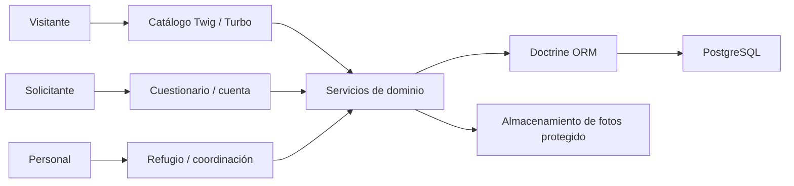

# Memoria de Huellas · Iteración HU-01 a HU-04

## Portada y resumen

Ingeniería de Requisitos, Trabajo Grupal. Fecha: 2026-11-05. Integrantes y grupo académico:
pendientes de identificación en agrupamiento.md. Huellas es una aplicación para que una protectora
conserve la información de sus animales y coordine las adopciones. Esta iteración implementa
la llegada y cuarentena, el catálogo público, las solicitudes y su evaluación, con validación
de servidor, persistencia PostgreSQL y evidencias reproducibles. Es una memoria parcial de las
cuatro historias encargadas, no el cierre de las ocho historias del proyecto.

## URL repositorio GITHUB

https://github.com/aggg15/huellas-protectora

main contiene la base publicada. El trabajo actual se conserva en las ramas secuenciales spec-001 a spec-004 y
la revisión e integración del compañero no se presentan como realizadas.

## Introducción

La asociación Huellas necesita una memoria común frente a la información dispersa entre personas,
cuadernos y mensajes. El sistema debe evitar ofrecer animales en cuarentena o ya reservados,
recoger candidaturas completas y permitir una decisión coherente sobre cada animal. Se ha leído
la narrativa SI-30, la guía SDD y el enunciado general v1 actualmente presente en la carpeta.
El contexto de esta iteración se limita al proyecto grupal, conforme a la instrucción del usuario.

## Análisis

Los actores de este alcance son visitante, solicitante, voluntario, veterinario y coordinadora.
La autenticación es soporte de sus operaciones y no una novena historia. El catálogo no requiere
registro; las cuentas públicas no reciben permisos internos. Los requisitos funcionales se
concretan en las cuatro specs y sus 18 criterios originales, sin eliminar identificadores.

Los requisitos de calidad incluyen datos ficticios, formularios etiquetados en español,
validación de servidor, CSRF, exclusión de fotos no públicas, ausencia de cambios parciales y
consistencia ante concurrencia. La [matriz](trazabilidad.md) indica criterio, plan, tarea, código
y prueba. Las ambigüedades y justificaciones se conservan en [decisiones](decisiones.md).

El enunciado v1 cambia los entregables y exige specs/, agrupamiento y memoria con este índice.
Sus referencias contradictorias a dos/cuatro integrantes se interpretan con la guía específica;
no se inventan nombres o un reparto aceptado por el compañero.

## Diseño

Una aplicación Symfony 7.4, Twig, Hotwire (Turbo y Stimulus), Doctrine y PostgreSQL 16, con Bulma.
Se conserva la estructura estándar de Symfony en la raíz. La mención a apps/ y packages/ del
índice de ejemplo no justifica crear aplicaciones separadas o paquetes sin uso. La arquitectura
y las convenciones comunes están en [plan.md](../plan.md); el [modelo](../data-model.md) comparte
identificadores, estados y relaciones entre las historias.

La cuarentena se libera a las 240 horas y las fechas se guardan en UTC. Las fotos se almacenan
fuera de public/. El límite de solicitudes bloquea la cuenta y el animal; aprobar bloquea el
animal y actualiza su estado y candidaturas en una transacción. Versiones e índices parciales
evitan sobrescrituras y reservas dobles. No se usan bases o módulos independientes por historia.

## Implementación

- HU-01: AnimalService, PhotoStorage, entidades de animal/foto/revisión, permisos y pantallas internas.
- HU-02: CatalogController y consultas de disponibilidad y filtros; no expone notas veterinarias.
- HU-03: AccountService, ApplicationService, UserRepository, cuestionario, listado propio y recepción
  restringida de coordinadora. Las contraseñas se almacenan como hash y el email se normaliza.
- HU-04: ReviewService y operaciones de entrevista, rechazo, aprobación y liberación de reserva.
  Cada decisión conserva coordinadora y fecha, y las otras candidaturas activas esperan.

Turbo gestiona navegación y formularios; Stimulus previsualiza fotos, cuenta respuestas y solicita
confirmación de las decisiones. Los recursos de npm se sirven desde la aplicación. Composer y npm
conservan lockfiles, y las migraciones son acumulativas. El arranque no crea cuentas con contraseñas
predefinidas; el comando app:create-user pide la contraseña de forma oculta.

## Pruebas y validación

Se validó cada historia antes de pasar a la siguiente: 7, 12, 21 y 29 pruebas acumuladas. El
refinamiento añadió el acceso real con email normalizado, hasta **31 pruebas y 169 aserciones**.
Las pruebas de concurrencia usan procesos y conexiones independientes de PostgreSQL. La base
_test se separa de los datos de aplicación y los scripts comprueban su nombre antes de limpiarla.

El navegador realiza 11 comprobaciones correctas, con captura en móvil/escritorio y sin errores
JavaScript. Dos recorridos integrados son solicitud → entrevista → reserva y solicitud → rechazo,
además del error de la tercera solicitud. Los resultados, entradas, pasos y límites se resumen en
[verificacion.md](verificacion.md), con enlaces a registros completos y JUnit.

La [revisión de refinamiento](informes/refinamiento.md) distingue ambigüedades, coherencia documental,
comportamiento de aplicación y problemas del propio entorno de prueba. La revisión del compañero
sigue pendiente y no se atribuyen sus decisiones ni su evaluación a Codex.

## Despliegue y uso

El [README](../README.md) incluye instalación Docker y PHP local, generación de secretos locales,
creación de cuentas y el manual breve de las cuatro historias. La configuración se basa en
.env.example; los valores locales no se versionan. El servidor Docker utiliza PostgreSQL y un
volumen de fotografías. La interfaz se publica solo en loopback, por defecto en el puerto 8086.

El flujo es: voluntario registra llegada, veterinario revisa, visitante consulta, solicitante
presenta cuestionario y coordinadora entrevista y decide. El mínimo necesario para acceder al
personal se crea con app:create-user. No se requiere una CDN durante la ejecución de la aplicación.

## Planificación y seguimiento

| Hito | Referencia | Validación antes del siguiente |
|---|---|---|
| Base anterior | c065f7d | Documentación inicial y repositorio. |
| spec-001 | 7bcea03 | Siete pruebas de ficha y cuarentena. |
| spec-002 | 7873d5a | Cinco nuevas y regresión de las siete anteriores. |
| spec-003 | d21fc41 | Nueve nuevas y regresión; límite concurrente. |
| spec-004 y refinamiento | Rama spec-004 | Entrevistas, reserva concurrente y cierre integrado; commit de esta rama. |

Los ficheros tasks.md registran el trabajo y las correcciones reales, preservando las tareas
originales. Analyze y converge se documentan por historia. No se han creado issues o PR ni se ha
hecho una revisión cruzada humana; no se atribuye su existencia a esta memoria.

## Conclusiones

Se obtiene la primera mitad funcional del sistema con trazabilidad y evidencias de los 18 criterios
del alcance. La revisión integrada permitió corregir la normalización del acceso, el entorno del
servidor PHP y la coherencia de índices. Las pruebas de navegador verifican aspectos que loginUser
y las pruebas de servicios no sustituyen, como sesiones reales y comportamiento de Hotwire.

Quedan HU-05 a HU-08, la revisión académica compartida, la integración en main y los entregables
finales del sistema. El enunciado pide dos ZIP (proyecto y demo MP4, máximo conjunto 100 MB); no se
generan como si las ocho historias o la demo estuvieran terminadas. Tampoco se afirma aptitud para
producción, verificación legal de identidad o pruebas de carga.

## Anexos

- [Especificaciones y fases](../specs/), [Constitution](../.specify/memory/constitution.md).
- [Trazabilidad](trazabilidad.md), [decisiones](decisiones.md), [agrupamiento](agrupamiento.md).
- [Evidencias](evidencias/) y [registro del refinamiento](informes/refinamiento.md).
- Glosario: cuarentena = diez periodos de 24 h; abierta = pendiente/en espera/aprobada;
  reserva = candidatura aprobada y animal reservado; acogida = estancia temporal compatible con
  disponibilidad; converge = contraste posterior con el código, sin sustituir las pruebas.
